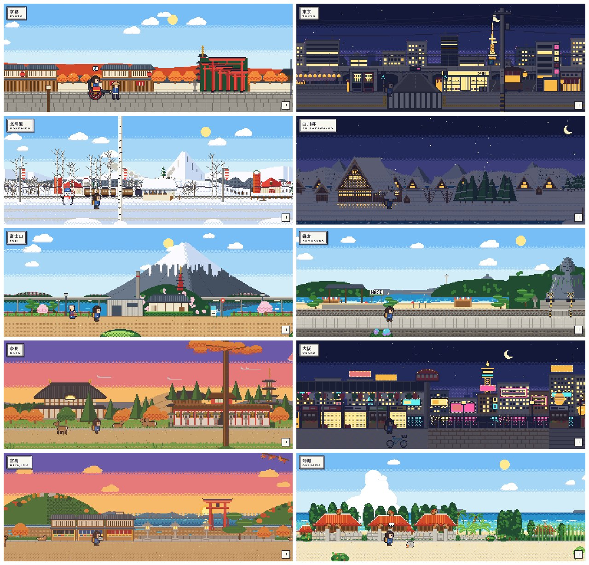
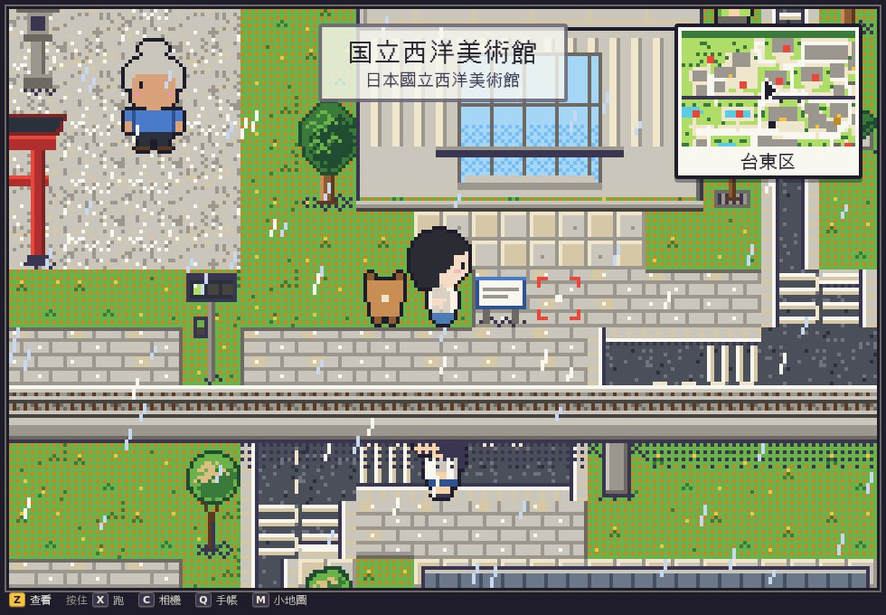
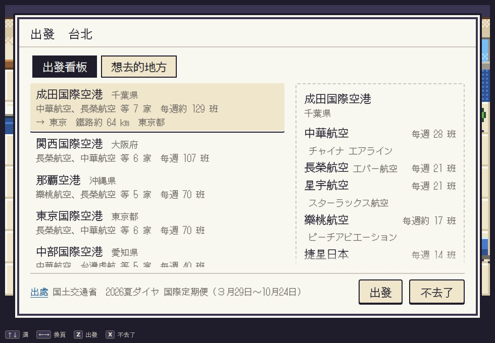

# ひとめぐり（一巡り／HITOMEGURI）

**網站**：[Firebase Hosting](https://hitomeguri-7d87a.web.app/) ・ [GitHub Pages](https://yo02741.github.io/hitomeguri/)

**形象網站**：[/about](https://hitomeguri-7d87a.web.app/about)（[Pages](https://yo02741.github.io/hitomeguri/about)） ・ **番外篇**：[/play](https://hitomeguri-7d87a.web.app/play)（[Pages](https://yo02741.github.io/hitomeguri/play)）

把日本走一圈。

日本景點地圖與旅前準備：先排必去的景點，再用擴充包找值得專程去的小點，出發前整理好行程、念法與會用到的日文。

## 功能

- **探索**：47 縣的景點地圖。
  - 景點卡片有照片、假名／漢字／羅馬拼音、最近車站和維基百科簡介。
  - 可依類型篩選，也能用日文、假名、中文、羅馬拼音搜尋。
  - 地區頁一律顯示鐵路路線與車站，也有市区町村的區界；進到一縣可以只看這一縣。
- **擴充包**：
  - 寶可夢（人孔蓋、寶可夢中心與商店）
  - 城（日本100名城・続日本100名城，名城番號與スタンプ設置場所）
  - 老舖・茶屋（香舖、和菓子、茶舖、茶屋・甘味處）
  - 角色商店
- **深度探索**：各縣的季節（花期月曆）、祭典、地區特色（郷土料理、特色拉麵）、期間限定。
- **期間限定**：氣象廳的櫻花、紅葉觀測，每天自動更新；連鎖店的限定品提供快捷搜尋與截圖收藏。
- **收藏與紀錄**：收藏、去過（含日期）、自訂清單。
  - 旅行紀錄地圖、經縣值、分享圖。
  - 匯出 KML、CSV、Google Maps 連結。
- **行程**：
  - 把景點排進每一天，也可以用邀請連結和旅伴共編。
  - 設好每天住的車站，列出當天來回得了的地方。
  - 出發前的旅前準備：地名念法、情境會話、練習卡。
  - 旅前小書，可列印或存成 PDF。
- **收集**：
  - 景點收集卡：抽獎券由去過的地方算出來；收集冊裡另有「浮世繪裡的景點」。
  - 旅人：自己的紙娃娃，各縣的服裝與地區背景，展示窗是 3D。
  - 成就：紀念章帳，初訪 47 縣與 40 個成就。
- **年代主題**：江戶、明治、大正、昭和、平成、令和，整個網站換色與字型。
- **離線**：PWA，看過的頁面沒有網路也打得開；行程可以先把這趟的資料與地圖下載好。

## 形象網站（/about）

介紹 ひとめぐり 的一頁：這個網站想做什麼、能做什麼、一趟旅行怎麼用。

- 全版的風景輪播，由北到南八張（羊蹄山到川平灣），照片取自景點資料的 Commons 照片並標作者與授權。
- 「能做什麼」分頁籤，每一頁都有按鈕直接到網站的那一頁；「一趟旅行怎麼用」六個步驟。
- 像素散步：GBA 風的旅人走過北海道、白川鄉、東京、鎌倉、富士山、京都、奈良、大阪、宮島、沖繩 10 區，路上隨機遇到 65 種小事，換區有新幹線、渡輪、飛機等 8 種。登入、玩過番外篇的話，走的是你的旅人。旁邊的「自己走」進番外篇。
- 六個年代（點了整頁換過去）、資料從哪裡來、常見問題。



## 番外篇：像素遊戲（/play）

GBA 風的俯視走格子遊戲。主角是你在旅人頁穿好的旅人，變成像素人，夥伴跟在後面。沒有戰鬥，就是當個旅人：拍照、買伴手禮、蓋章。

- **從台灣出發**：新遊戲先選出發的城市（台北、台中、高雄），在機場的出發看板選直飛的日本機場。航線、航空公司與每週班次取自国土交通省的國際線就航表；也可以先選想去的鎮，看從哪個機場飛、再坐電車最近。日本的國際機場可以回台灣。
- **7 縣 63 鎮**：京都、沖繩、奈良、大阪、兵庫、東京、北海道各 9 鎮，照真實的景點、車站與市区町村選，鎮的地圖由資料生成（方向大致對、距離壓縮）。鎮與鎮、縣與縣之間坐電車、新幹線、巴士、飛機，只寫距離。
- **能做的事**：拍照（構圖分數、一個地標一頁的相簿）、買東西（円；車站的賣店可以刷卡，老舖・茶屋只收現金）、在食堂吃郷土料理、印帳（站章、參拜印、名城的章，圖案是遊戲自製的）、你的房間、路人的委託。
- **事實有出處**：告示牌的簡介、祭典、創業年、平年的花期、鐵路距離都來自網站的資料並附出處；季節照氣象廳的平年值換，祭典的月份鎮上有攤子。路人的閒聊是虛構的，不提真實的地名。
- **操作**：方向鍵／WASD 走、Z 查看、按住 X 跑、C 相機、Q 旅人手帳、M 小地圖、P 暫停；手機有十字鍵與 A／B。畫面下緣有小小的按鍵提示，設定可以關。
- 存檔放在這台裝置，不動網站的紀錄、收集卡與成就。入口：形象網站的「自己走」、旅人頁的「帶旅人去走走」。





## 部署

| 位置 | 網址 | 部署方式 |
|---|---|---|
| Firebase Hosting | https://hitomeguri-7d87a.web.app/ | 推送 `main` 時由 `.github/workflows/firebase-hosting.yml` 部署（只部署 Hosting） |
| GitHub Pages | https://yo02741.github.io/hitomeguri/ | 推送 `main` 時由 `.github/workflows/pages.yml` 部署 |

- Firestore 規則（`firestore.rules`）不會自動部署，修改後要貼到 Firebase Console 發布。
- 只用 Firebase 的免費方案（Spark）：Hosting、Firestore、Auth；不用 Functions、Storage。

## 文件

| 檔案 | 內容 |
|---|---|
| `PLAN.md` | 開發規格：技術棧、資料 pipeline、資料模型、開發階段、工作規則、文案原則 |
| `UX-FLOW.md` | 資訊架構、地區色規則、User Stories、UI flow、路由 |
| `DESIGN.md` | UI 設計準則與 Tailwind 元件配方；§14 形象網站、§14a 像素散步、§14b 番外篇 |
| `CLAUDE.md` | 給 Claude Code 的專案規則 |
| `docs/驗收.md` | 需要使用者做的事、各功能的驗收說明（一份） |
| `docs/PROGRESS.md` | 目前狀態、開發紀錄、使用者決定、已知限制、之後要做 |
| `docs/參考/` | 設計研究、使用流程盤點、手機版計畫、效能檢測、skill 回顧、遊戲用的 skill、番外篇的技術 |
| `docs/screenshots/` | 驗收與研究用的截圖 |

## 結構

```
data/            主資料（JSON，source of truth；景點、擴充包、地區特色、祭典、鐵路、期間限定、會話、航線）
pipeline/        Python 資料 pipeline（採集、對齊、資料檢查、變更報告、產生 bundle 與番外篇的 game bundle）
web/             Vue 3 + Vite + TypeScript + Tailwind v4 + MapLibre 前端
  src/services/pixelwalk/   形象網站的像素散步
  src/game/                 番外篇的像素遊戲（引擎、旅人、聲音、世界、系統）
docs/            狀態、驗收說明與研究
.github/         CI、部署、資料採集與排程的 workflow
firebase.json    Hosting + Firestore + Auth
```

## 資料怎麼更新

外部資料的採集都在 GitHub Actions 上跑。

- **自動**（`refresh-data.yml`）：採集完推到 `pipeline/refresh-<編號>` 分支並開 PR，PR 描述附變更報告與資料檢查結果，合併後自動部署。
  - 每週一：寶可夢、城、祭典。
  - 每月第一週：再加老舖、角色商店、地區特色、各縣維基簡介。
  - 每季第一週：再加各縣景點重採。
- **每天**（`harvest-timed.yml`）：期間限定，有變更直接提交 `main`。
- **手動**（`seed-region.yml`、`seed-pack.yml`）：推到 `pipeline/*` 分支，檢查後合併。番外篇用的台灣出發航線是 `seed-pack.yml` 的 `seed-taiwan-routes`。
- 番外篇的每縣資料與世界索引不另外採集，`build-bundles` 時從 `data/` 一起產生。

## 本機開發

需要 Node 22、Python 3.11、uv、Java 17+（Firebase Emulator）。

```bash
# 前端
cd web && npm install
cp .env.example .env.local        # 填 Firebase Web 設定；只用 emulator 時可先留空
npm run dev                       # http://localhost:5173（形象網站 /about、番外篇 /play）
npm run typecheck && npm run test && npm run build

# Firebase Emulator（Auth + Firestore），另開一個終端
npx firebase emulators:start --project demo-hitomeguri --only auth,firestore

# pipeline
uv venv && uv pip install -e ".[dev]"
.venv/bin/python -m pipeline.cli build-region-css   # 由 data/regions.json 重新產生 regions.css
.venv/bin/python -m pipeline.cli build-bundles      # data/ → web/public/bundles/（含番外篇的 bundles/game/）
node web/src/game/fixtures/build-fixtures.mjs       # 番外篇測試用的 fixture（game bundle 改了才要重做）
.venv/bin/python -m pipeline.cli validate-data      # 資料檢查
.venv/bin/ruff check pipeline && .venv/bin/pytest -q
```

`npm run dev` 時前端預設連本機 emulator；正式 build 一律連真實的 Firebase 專案。

## 資料出處

- 景點：Wikidata（CC0）、OpenStreetMap contributors（ODbL）
- 照片：Wikimedia Commons，各張依原作者與授權標示於卡片
- 簡介與部分念法：維基百科（中文、日文、英文）開頭段落，CC BY-SA 4.0，卡片標示出處條目；中文經 OpenCC 做簡繁字元轉換，英文簡介另有中文翻譯
- 郷土料理：農林水產省「うちの郷土料理」（公共データ利用規約 第1.0版）
- 季節與期間限定：氣象廳 生物季節観測（公共データ利用規約 第1.0版）
- 祭典、特色拉麵、100 名城、老舖：日文維基百科的分類與一覽條目（CC BY-SA 4.0）
- 寶可夢人孔蓋：ポケモンローカルActs 官方頁面（只存名稱、位置與連結，不使用圖片）
- 縣界：出典：地球地図日本（国土地理院），經 dataofjapan/land 轉為 GeoJSON 後簡化
- 市区町村界：「国土数値情報（行政区域データ）」（国土交通省）をもとにひとめぐり作成（CC BY 4.0，經簡化）
- 國際線的機場、台灣出發的直飛航線：国土交通省「各空港における国際線就航状況調べ」；航空公司的中文名取各航空公司的繁體中文網站
- 底圖：OpenFreeMap（OpenStreetMap）
- 番外篇的像素圖、音樂、台詞都是自製的，不用其他遊戲的素材
