# 驗收

ひとめぐり 各功能的驗收說明，原本分成 15 份（2026-10-15 合成這一份）。手機勾選清單：https://claude.ai/artifact/41cnWb2qBYCfLskzfDCuJV 。
網站：https://hitomeguri-7d87a.web.app/ 、https://yo02741.github.io/hitomeguri/ 。開發進度、使用者決定、已知限制見 `docs/PROGRESS.md`。

## 需要你做的事

- **Firestore 規則**：`firestore.rules` 貼到 Firebase Console 發布。這幾次加的：收集卡 `users/{uid}/cards`（封面欄位 `c`、這裡做過的事 `t`）、旅人 `users/{uid}/meta/avatar`、抽獎券 `users/{uid}/meta/wallet`、經縣值。沒發布前抽到的、勾的只存在這台裝置。
- **正式上線前**：`web/src/services/cardVariants.ts` 的 `UNLIMITED_DRAWS` 改成 false，清空 Firestore 的 `users/*/cards`、`users/*/meta/wallet`。
- **自動化排程**：合併第一個自動 PR，觀察一週的週一排程（見「自動化排程＋PR 審核」）。
- **還沒決定的**：
  - 期間限定要不要維持每天直接提交 main（目前維持，使用者 2026-10-09 決定）。
  - 字型：可變字型的 900 要不要拿掉（換靜態字型、所有標題從 900 變 700；見 `docs/參考/效能檢測.md`「字型精簡」）。
  - 設計：`docs/參考/設計質感研究.md` 最後「需要你決定的」。
- **會話**：109 句已逐句上網查出處（2026-10-09）：96 句附出處網址，7 句照出處改寫，13 句找不到出處、先留著。`data/phrases` 的 `reviewed: false` 待校對。
- **換季時**：機場清單換新一季的国土交通省 Excel（步驟見 `docs/PROGRESS.md`「定期要做的事」）。
- **要用時**：直飛航線查證、英文簡介翻譯要在 Actions secrets 加 `ANTHROPIC_API_KEY`。

## 總表

| 範圍 | 狀態 | 段落 |
|---|---|---|
| 擴充包（寶可夢、城、老舖・茶屋、角色商店） | 上線，等驗收 | 擴充包 |
| 期間限定 v1（氣象廳） | 等驗收 | 期間限定 |
| 收藏、去過、清單、匯出 | 等驗收 | 收藏、去過、清單、匯出 |
| 行程、旅前準備、練習、旅前小書、截圖收藏 | 等驗收 | 行程、旅前準備、練習；第一輪回饋的修改 |
| 行程共編 | 等驗收 | 行程共編 |
| 自動化排程＋PR 審核 | 等第一次自動 PR 與一週排程 | 自動化排程＋PR 審核 |
| 收集卡、收集冊、開場動畫、操作過渡、新卡入手、季節飄落、路線繪製 | 上線 | 特效與收集卡 |
| 年代主題（江戶～令和）、新卡種、十連抽、季節照片 | 等驗收；cards 規則要貼 | 年代主題 |
| 離線（PWA）、經縣值、分享圖、位置小框、開卡包、換縣墨暈、景點整理 | 等驗收；經縣值規則要貼 | 離線、經縣值…（第三輪） |
| 旅人（478 件服裝、扭蛋、十連抽、3D 展示窗、散步的旅人）＋抽獎券 | 等驗收；meta/wallet 規則要貼 | 旅人（紙娃娃）與抽獎 |
| 成就（紀念章帳、成就服裝、抽獎券） | 等驗收；規則不用改 | 成就 |
| 手機版面（1024 以下）三個階段 | 等實機驗收 | 手機版面 |
| 縣內規劃（專心模式、小區塊、車站、日帰り）、國際機場、形象網站 `/about` | 等驗收；沒有獨立的驗收段落 | `docs/PROGRESS.md`、UX-FLOW.md A1c、A2b、B5、C8，DESIGN.md §14 |

## 目錄

1. 擴充包：城、老舖・茶屋、角色商店
2. 期間限定（Phase 4）
3. 收藏、去過、清單、匯出（Phase 5）
4. 行程、旅前準備、練習（Phase 7）
5. 第一輪回饋的修改（Phase 4、5、7）
6. 行程共編
7. 自動化排程＋PR 審核（Phase 6）
8. 特效與收集卡
9. 年代主題
10. 離線、經縣值、分享圖、位置小框、景點整理（第三輪）
11. 旅人（紙娃娃）與抽獎
12. 成就
13. 手機版面：第一、第二、第三階段

## 擴充包：城、老舖・茶屋、角色商店

（原「擴充包驗收：城、老舖・茶屋、角色商店」）

完成日期：2026-09-30
網站：https://hitomeguri-7d87a.web.app/

你選的三個擴充包（老舖、城、角色商店，不做溫泉、酒、拉麵、居酒屋與自駕）都上線了。地圖上方的擴充包列多了三顆按鈕；按下去左側清單換成擴充包的點，地圖只剩擴充包的點可以選。

### 城（日本100名城・続日本100名城）

- 197 座：日本100名城 100、続日本100名城 97。
- 194 座對到既有的景點：點了直接開景點卡片，資訊列多一行「名城 No.○○」與スタンプ設置場所。沒有對到的 3 座以擴充包的點顯示。
- 等待中的每週自動 PR [#1](https://github.com/yo02741/hitomeguri/pull/1) 會再加上玄蕃尾城、勝瑞城（共 199 座）。品川台場 OSM 沒有同名的點，找不到位置。
- 來源：日文維基百科「日本100名城」「続日本100名城」一覽表（名城番號、スタンプ設置場所），座標、念法、中文名取 Wikidata。

### 老舖・茶屋（502 家）

| 組別 | 家數 | 從哪裡來 |
|---|---|---|
| 香舖 | 6 | 維基百科有條目的：鳩居堂（京都）、奥野晴明堂（大阪，1716 年）。OSM 補的：青木玉初堂、岩井香舗、山田松香木店、薫玉堂 |
| 和菓子 | 55 | 維基百科「和菓子の店舗・メーカー」，創業在 1926 年以前 |
| 茶舖 | 5 | 維基百科「日本の製茶メーカー」：一保堂（1717）、山本山（1690）、あいや、岩田園、綱島園 |
| 茶屋・甘味處 | 436 | OSM 名稱含茶屋、茶寮、茶房、甘味的店，每縣最多 12 家 |

- **創業年**：日文維基的公司資訊框多半只寫「設立」（公司登記年），創業寫在設立欄的括號（「創業：1690年」）或第一段（「1705年（宝永2年）創業」）。從這兩處找；都沒有時看 Wikidata 與「…年設立の企業」分類。卡片上顯示「創業 1717年」。
- **位置**：Wikidata 或條目的座標；都沒有時到 OSM 找本店所在縣（資訊框的本店／本社所在地）同名的店，有本店用本店，同縣好幾家又沒有本店就不猜。
- **你點名的三家**：
  - 鳩居堂：京都的店（OSM）。
  - 薫玉堂：OSM 只有東京的店，京都本店不在 OSM。
  - 松栄堂：維基有條目（1705 年創業），但京都的店不在 OSM，也沒有座標，所以這次沒有收進來。
- **沒收的**：創業晚於 1926 年 118 家；查不到創業年 33 家（赤福、御福餅等，條目沒寫年份）；找不到店的位置 66 家（聖護院八ツ橋総本店、文明堂、森八、上林春松本店、祇園辻利等：OSM 沒有這家、或同縣好幾家同名又沒有本店）。完整清單在採集報告。
- **茶屋・甘味處**的名稱含中華、食堂、レストラン、Bar、カレー、分店編號的已排除（天下茶屋、甘酒茶屋、中島の御茶屋 保留）。其他不像茶屋的，可以告訴我店名加進排除規則。

### 角色商店（96 家）

任天堂 4、吉卜力 8、三麗鷗 35、吉伊卡哇 4、星之卡比 4、航海王 6、Jump Shop 13、史努比 14、迪士尼 8。

- 取 OSM 的店、咖啡廳與博物館、主題樂園，依店名判斷品牌。遊樂設施（USJ 的フライング・スヌーピー等）、園區看板不收；同一個地方的重複（三鷹の森ジブリ美術館原本有三筆）只留一筆。
- 不使用角色圖、logo；只有店名、地址、官方網站與 Google Maps 連結。
- 待確認：「カレーハウス サンリオ」（宮崎）名稱含サンリオ，看不出是不是三麗鷗的店。

### 更新

- 每週一的自動採集（`refresh-data.yml`）更新城；老舖・茶屋、角色商店每月第一週更新，結果開成 PR 給你審。
- 手動：Actions → seed-pack → 選 `seed-castles`、`seed-shinise` 或 `seed-chara`。

### 請你驗收

- [ ] 地圖上方打開「城」：京都、愛知等縣的名城點了會開景點卡片，資訊列有名城番號與スタンプ設置場所。
- [ ] 打開「老舖・茶屋」：京都有鳩居堂、一保堂、鶴屋吉信、川端道喜等；卡片有創業年、地址、官方網站。
- [ ] 打開「角色商店」：東京有任天堂、吉卜力、三麗鷗等，依品牌分組。
- [ ] 松栄堂、薫玉堂的京都本店要不要補位置：可以把官方網站上的地址用國土地理院的地址檢索換成座標（要你同意使用這個服務），或等 OSM 有人登錄這兩家店。
- [ ] 茶屋・甘味處每縣 12 家的上限是否合適（全國符合的有 871 家）。

## 期間限定（Phase 4）

（原「Phase 4 驗收：期間限定（v1）」）

完成日期：2026-09-29
網站：https://hitomeguri-7d87a.web.app/

Phase 4 只做了一部分。畫面、每天自動更新、過期自動移除都做好了，但資料來源目前只有氣象廳的季節觀測。PLAN.md 原本列的超商、麥當勞、PR TIMES，查過使用條款後都不能轉載，所以沒有接。

### 來源查核結果

| 來源 | 結果 | 原因 |
|---|---|---|
| 氣象廳 生物季節観測 | **接了** | 採「公共データ利用規約 第1.0版」，註明出處就可以使用。 |
| 7-Eleven 新商品（有依地區分頁） | 不接 | 使用規約「著作権について」：超出私人使用等法律允許範圍的使用（複製、頒布等）都不行。 |
| PR TIMES | 不接 | 一般使用者規約第 6 條：只能用於瀏覽、私人使用或引用。 |
| FamilyMart、LAWSON、麥當勞 | 不接 | 網站有 robots.txt，但我抓的條款網址都是 404，推定條款和 7-Eleven 類似。 |
| 花火大會、祭典的今年日期 | 還沒有 | 找到的開放資料候選是 BODIK 收集的各市町村「イベント一覧」（多為 CC BY），但它的 API 當天回 502，還沒評估。 |

這和先前農林水產省照片的情況一樣：需要對方同意才能用的，就不自己抓。

### 做了什麼

- **資料**：每天從氣象廳本季的觀測頁抓三種：
  - 櫻花：開花日、滿開日（官網 12 月到 6 月更新）。
  - 銀杏轉黃（いちょう黄葉）、楓葉轉紅（かえで紅葉）：秋天更新。
  - 每個觀測站變成一筆「期間限定」，掛在該站所在的縣。
- **顯示多久**：這是本站自己訂的規則，不是氣象廳發表的「最佳觀賞期」。
  - 櫻花：從開花日到「滿開日（還沒滿開就用開花日＋7 天）＋7 天」。
  - 銀杏、楓葉：觀測日起 14 天。
- **文字**：中文說明用固定句型組出來，例如「京都的氣象台 11月20日 觀測到楓葉轉紅，比平年早 3 天。」沒有用 AI。
- **出處**：列表下方標示「出典：気象庁ホームページ（生物季節観測）を加工して作成」，點了連到氣象廳原頁。這是公共資料規約要求的寫法。
- **在哪裡看到**：
  - 地區地圖左側面板多一張「期間限定」卡片，列出前三筆（依結束日排序），超過三筆時有「全部」連到深度探索。
  - 深度探索頁新增「期間限定」段落，放在地區特色後面，含說明與出處。
  - 旅前準備頁：行程日期內、行程經過的縣的期間限定會列出來。
- **過期自動移除**：
  - 每次建置網站只輸出還沒過期的項目。
  - 瀏覽器也會依當天日期再過濾，所以就算當天沒有重新部署，過期的也不會顯示。
- **每天自動更新**：新增 `harvest-timed.yml`，每天日本時間 17:50 執行（氣象廳約 17:30 更新）。
  - 有新資料就直接提交到 `main`，再觸發 Firebase Hosting 和 GitHub Pages 部署。
  - 這和其他採集流程不同，其他的都先推到 `pipeline/*` 分支給你審。理由是這份資料是氣象廳發表的觀測日，解析規則固定而且有測試。
  - 你想改回先審再合併也可以。

### 現在看得到什麼

現在是 9 月底：

- 今年的櫻花觀測都已經過期，所以列表是空的。
- 楓葉、銀杏的觀測通常 10 月中旬從北海道開始，到時候每天會陸續出現。

在那之前，網站上看不到期間限定的內容。我用暫時的測試資料確認過畫面，測試資料沒有提交。

### 請你驗收或決定

- [ ] **自動提交**：接受 `harvest-timed` 直接提交到 `main` 嗎？還是要改成推到審核分支、由你合併？
- [x] **商品類**：你決定不能抓就不抓（2026-09-30）。改成連鎖店的 Google 快捷搜尋，和自己上傳的截圖收藏，見 本文件「第一輪回饋的修改（Phase 4、5、7）」。
- [ ] **花火、祭典**：要不要繼續評估 BODIK 的市町村活動資料？目前看到的只涵蓋部分市町村，而且多是地方活動，不一定有觀光價值。
- [ ] 10 月中旬後打開北海道、東北的地區頁，確認出現楓葉、銀杏的期間限定。

### 還沒做到或沒測到的

- **沒測到的**：畫面上真的出現期間限定，要等 10 月中旬有新的秋季觀測。自動提交和部署那一段已經實際跑過一次（見下面「執行紀錄」）。
- **不能點到地圖上的位置**：期間限定項目沒有座標，因為氣象觀測站的座標沒有收錄，只能對應到縣。
- **首頁不顯示**：全國首頁沒有期間限定清單，只在地區頁和深度探索頁。

### 執行紀錄

2026-09-29 手動觸發一次 `harvest-timed`（#1），整條流程都成功：抓資料 → 提交到 `main`（commit `051f971`，作者 hitomeguri-pipeline）→ 觸發 Firebase Hosting、Pages 部署。

- 櫻花：58 站今年已開花，全部已過期，存在 `data/timed/2026-01.json`～`2026-05.json` 當紀錄。
  - 例：京都 3/23 開花、3/30 滿開，顯示期間 3/23–4/6。
- 銀杏轉黃、楓葉轉紅：0 站，今年秋天還沒開始觀測。
- 目前沒過期的：0 筆，所以網站上還看不到。
- 之後每天日本時間 17:50 自動執行。

## 收藏、去過、清單、匯出（Phase 5）

（原「Phase 5 驗收：收藏、去過、清單、匯出」）

完成日期：2026-09-29（commit `6f6071b`）
網站：https://hitomeguri-7d87a.web.app/

Phase 5 做完了，已經部署，建置和檢查都通過。我在本機的 Firebase 模擬器上測過收藏、去過、清單、改名、匯出和權限規則，正式網站上還要請你實際操作驗收。

### 功能

- **景點卡片**多了三個按鈕：
  - **收藏**：再按一次取消。
  - **去過**：按下後可以填日期，不記得可以不填。
  - **清單**：勾選要放進哪些清單，也可以在這裡直接新增清單。
- **沒登入時**按這些按鈕，會先跳出 Google 登入，登入後自動完成剛才的動作。儲存會等你原本的資料讀完才寫入，不會蓋掉你之前存的收藏。
- **地圖**：
  - 收藏的景點外面多一圈。
  - 去過的景點右上角有一個藍色小圓點（設計稿裡的印章色）。
  - 地圖上方有「收藏」開關，打開後只顯示收藏的景點，並自動移到看得到全部收藏的位置。
- **頭像選單 →「收藏與清單」**（原本叫「收藏與設定」，因為這頁主要是收藏和清單，所以改了名）：
  - 列出全部收藏。
  - 顯示各清單和裡面的景點數。
  - 下方是帳號資訊和登出。
- **清單頁**：可以改名、刪除清單，或把景點從清單移除。刪除清單不會影響景點本身的收藏和去過。
- **紀錄頁**：上方是「全部去過」地圖，下方是去過的景點，依日期新到舊排列。
- **匯出**：收藏、每個清單、去過都可以匯出成兩種檔案，每個景點都附 Google Maps 連結。
  - **KML**：每個縣分一個資料夾，可以匯入 Google My Maps。
  - **CSV**：Excel 直接打開不會亂碼。

### 請你驗收

- [ ] **更新規則**：到 Firebase Console → Firestore → 規則，把 repo 裡 `firestore.rules` 的新內容貼上並發布。
  - 新規則限制每筆資料能寫哪些欄位、格式和長度，也擋掉讀寫別人的資料。
  - 目前的舊規則也能用，只是比較寬鬆。
  - 之後 Phase 7 也會改規則，可以等 Phase 7 做完一起貼最新版。
- [ ] **收藏幾個景點**：到「收藏與清單」按「匯出 KML」。
- [ ] **匯入 My Maps**：到 Google My Maps 建立新地圖，按「匯入」選這個檔案，確認景點位置和名稱都對。這是 PLAN.md 裡這個階段的驗收條件。
- [ ] 沒登入時按「收藏」：跳出 Google 登入 → 登入後景點自動收藏好。

### 還沒做到或沒測到的

- **Google Maps 轉乘路線連結**：這要有先後順序才有意義，所以放到 Phase 7 行程的「每一天」。目前的匯出檔裡，每個景點各有一個 Google Maps 連結。
- **沒測到的部分**（這些要請你實際用一次）：
  - 「沒登入時按收藏 → 跳出 Google 登入 → 自動完成」這段，我這邊的測試環境沒辦法操作登入彈窗。
  - 照片標記上的星形和圓點，這邊載不到景點照片，所以沒看到實際效果。
- **叢集時看不到記號**：地圖拉遠、景點合併成數字圓圈時，收藏和去過的記號會看不到。

## 行程、旅前準備、練習（Phase 7）

（原「Phase 7 驗收：行程、旅前準備、練習」）

完成日期：2026-09-29
網站：https://hitomeguri-7d87a.web.app/

Phase 7 做完了，已經部署，建置和檢查都通過。我在本機的 Firebase 模擬器上測過建立行程、加入景點、排序、換天、拖曳、匯出、旅前準備、練習和進度儲存，也測過新的權限規則；正式網站上還要請你實際操作驗收。

### 行程（7a）

- **景點卡片**多了「加入行程」按鈕（卡片下方變成兩排：收藏、去過／清單、加入行程）：
  - 列出還沒結束的行程，每個行程可以選「待排」或某一天（DAY 1、DAY 2…附日期），按「加入」。
  - 已經在行程裡的景點顯示「已加入」，不會重複加。
  - 最下面可以直接新增行程，新增時這個景點會放進它的「待排」。
- **行程列表**（上方「行程」分頁，或頭像選單的「我的行程」）：
  - 可以直接新增行程，名稱、出發、回程都可以先不填。
  - 每張卡片上方是經過的縣的色帶（依天數分段），下面是名稱、日期、天數、地點數；旅途中的行程標「旅途中」。
  - 已結束的行程不在這裡，改到「紀錄」。
- **行程編輯頁**：
  - 可以改名稱和日期。出發和回程都填了，天數就跟著日期；日期縮短時，被拿掉那幾天的景點會移到「待排」。沒有日期時可以自己「加一天」「刪除這天」。
  - 每一天有 DAY 標記（顏色是當天主要所在縣的地區色），下面是依順序編號的景點。
  - 排序、換天有三種方式：
    - 直接拖曳（同一天換順序、拖到別天、拖進或拖出待排）。
    - 每列的「移到」選單。
    - 上下箭頭。
  - 同一天相鄰的兩個景點之間有「轉乘路線」連結，打開 Google Maps 的大眾運輸路線。Google Maps 的大眾運輸不支援中途點，所以一天的路線拆成一段一段。
  - 右邊地圖只顯示這趟的景點。點某一天，地圖只顯示那一天，並依順序畫虛線連起來；點「全部」回到整趟。點地圖上的景點，左邊清單會捲到那一列。
  - 匯出 KML（每天一個資料夾、待排放最後）和 CSV（前兩欄是「日」「順序」）。
  - 可以刪除行程，練習進度也一起刪掉。
- **紀錄頁**：
  - 已結束的行程（回程日期在今天以前）自動變成旅行紀錄，列在「旅行」。
  - 可以「補登旅行」：填名稱和以前的日期，建立後進入編輯頁補上景點。
  - 「去過」現在包含已結束行程裡的景點，日期用那一天的日期；你自己標的去過日期優先。
- **頭像選單**：在行程、旅前準備、練習頁時，「我的行程」會加粗。

### 旅前準備（7b）

在行程編輯頁按「旅前準備」。依這趟的內容即時組出來，不呼叫 AI：

- **今天**：旅途中才出現，列出當天的景點和車站。
- **地名與車站**：每個景點和它最近的車站，有假名、漢字、羅馬拼音、英文名、第幾天；車站會標出離哪個景點近。念法來自 Wikidata、OpenStreetMap、維基百科。
- **聽／說／讀**三區，各區依情境分組（車站・電車、超商結帳、付款、餐廳、購物、包裝，以及這趟用得到的主題）。「聽」的句子附建議回答。
  - 主題怎麼選：
    - 景點類型：寺社、博物館・美術館、城、樂園・動物園・水族館、公園・庭園。
    - 名稱有「温泉」的景點：溫泉。
    - 所在縣的地區特色：有拉麵就加拉麵店，有茶（例如宇治茶）就加茶屋，有酒就加酒藏。
  - 京都＋宇治的測試行程會出現：拉麵店、溫泉（嵐山温泉）、寺社、博物館、茶屋。
- **地區特色**：所在縣有假名的地區特色詞（例：宇治茶 うじちゃ）。
- **只看必備**：只留一定會遇到的句子和地名。
- **發音**：每個詞旁邊都有播放鈕，用瀏覽器內建的日文語音。

### 練習

在旅前準備按「開始練習」：

- 卡片來自這趟的地名、車站、會話和地區特色詞。正面是日文，翻面看假名、羅馬拼音、中文和補充（「聽」類附建議回答）。
- 勾「聽音」時正面不顯示文字，只播放發音。
- 按「記得」往上一箱，「再練一次」回第 1 箱，共 5 箱；每輪 20 張，低箱的先出。
- 上方的長條顯示各箱卡片數，下面是「熟練 x／總數」。
- 進度存在你的帳號裡，換裝置也在。
- 鍵盤：空白鍵或 Enter 翻面，→ 記得，← 再練一次。

### 請你驗收

- [ ] **更新 Firestore 規則**：把 repo 裡最新的 `firestore.rules` 整段貼到 Firebase Console → Firestore → 規則並發布（包含 Phase 5 和 Phase 7 的規則）。
  - 舊規則下行程和練習進度也都存得進去，只是檢查比較鬆（任何欄位都能寫）。
  - 新規則限制行程、練習進度能寫哪些欄位、日期格式、天數和箱號範圍。
- [ ] **校對會話**：`data/phrases/common.json` 和 `data/phrases/themes/*.json` 共 109 句。
  - 這些句子是我整理撰寫的，不是從某個來源擷取的，所以都標成 `reviewed: false`，請你看過。有問題的直接告訴我改哪句；看過沒問題的，我把 `reviewed` 改成 `true`。
  - 頁面最下方有一行小字註明「會話為編輯整理，尚待校對」，校對完我會拿掉。
- [ ] PLAN.md 的驗收條件：建立「京都＋宇治 3 天」行程 → 旅前準備列出所有景點與車站念法、茶／拉麵等主題會話（聽／說／讀分區）、宇治茶等特色詞；每個詞可以發音；練習可以進行並保存進度。
- [ ] 在手機上試拖曳：手機瀏覽器多半不支援拖曳，請改用「移到」選單和上下箭頭，看是否好用。

### 還沒做到或沒測到的

- **還沒做的**：
  - 旅途模式的離線使用（PWA）。
  - 針對單一景點的客製化詞彙。
  - 期間限定詞：要等 Phase 4 做完再接上。
  - 自訂地點（不在目錄裡的小店）、用照片匯入旅行、行程頁的直飛航線：直飛航線目前還沒有查證過的資料。
- **資料缺口**：有些車站在 OpenStreetMap 沒有假名，會只顯示漢字（例：北野白梅町）。
- **沒測到的**：
  - 發音是瀏覽器內建的語音，我這邊的測試環境沒有語音，沒聽過實際效果。
  - 手機上的拖曳。

## 第一輪回饋的修改（Phase 4、5、7）

（原「驗收回饋修改（Phase 4、5、7 第一輪回饋）」）

完成日期：2026-09-30
網站：https://hitomeguri-7d87a.web.app/

這一輪處理你在 Phase 4、5、7 驗收時提的回饋，都已經部署。我在本機的 Firebase 模擬器上測過每一項，也測過新的權限規則；正式網站上還要請你實際操作驗收。

**要先做的事：Firestore 規則又改了**。這次新增「截圖收藏」的兩個集合（`finds`、`find_images`），請把 repo 裡最新的 `firestore.rules` 整段貼到 Firebase Console → Firestore → 規則並發布。沒更新前，上傳截圖會失敗（顯示「沒有儲存成功」），其他功能不受影響。

### 1. 去過的日期、日期選擇器

- **日期位置**：景點卡片按「去過」之後，按鈕右半邊直接變成日期（今年的只寫月日，例如 `9/28`；沒填時寫「日期」）。點一下打開月曆，不再另外佔第三行。
- **自製日期選擇器**：全站原生的日期欄位都換掉了，共四處：去過日期、新增行程、行程編輯、補登旅行。
  - 日曆面板：星期日紅字、星期六藍字（日本月曆的習慣），今天有小圓點。
  - 點上方「2026年9月」可以切換到選月份，再點一次可以選年份，補很多年前的去過日期時比較快。
  - 行程的出發、回程合成一個欄位：先點出發、再點回程，中間的日期連成一條色帶，底部顯示「N 天」。只點出發就關掉時，行程沿用原本的天數。
  - 去過日期、補登旅行不能選未來的日期。
  - 可以用鍵盤操作：方向鍵移動、PageUp／PageDown 換月、Enter 選取、Esc 關閉。

- [ ] 景點卡片：標去過 → 點右半邊的日期 → 選日期，確認位置和樣子。
- [ ] 行程頁、行程列表的新增表單、紀錄頁的補登旅行，都試一次選日期。
- [ ] 在手機上試一次（面板會自動放在上方或下方，不會超出畫面）。

### 2. 清單上的快捷「去過」、批次補日期

- **快捷鈕**：下面這些清單的每一列右邊都多了一個勾勾圓圈，按一下就標成去過（像按愛心）：
  - 地區地圖左側的景點清單。
  - 收藏。
  - 自己建的清單。
  - 未登入時按下去會先登入，登入後完成。這裡只標去過，不填日期。
- **批次補日期**：紀錄頁「去過」旁邊新增「補日期」按鈕：
  1. 按下去之後每一列前面出現勾選框，**預設勾好還沒有日期的**。
  2. 上方工具列還有「沒有日期的」（重新勾選沒日期的）、「全選／全不選」和已選幾筆。
  3. 選日期，按「套用」，一次寫入。
  - 沒有日期的景點會標「沒有日期」。

- [ ] 在地區地圖的清單上連按幾個去過，到紀錄頁用「補日期」一次補上日期。

### 3. 旅前準備的段落目錄

- **桌機**：左側是段落目錄（今天／地名與車站／聽／說／讀／地區特色／期間限定，附數量）。捲到哪一段，目錄就標哪一段；聽、說、讀捲到時會展開到情境（車站・電車、付款、拉麵店…）。
- **手機**：目錄改成頂部的橫列，會跟著捲動標出目前段落。
- **錨點**：點目錄會平滑捲過去，網址變成 `…/prep#say` 這種形式。直接打開帶 `#` 的網址，會捲到那一段，情境也可以（例 `#say-restaurant`）。
- 標頭多了「旅前小書」按鈕（見第 6 節）。

- [ ] 在旅前準備頁上下捲動，看左側目錄跟得上；點目錄跳段；複製帶 `#` 的網址在新分頁打開。

### 4. 期間限定：連鎖店快捷搜尋

照你的決定，不能抓的就不抓。改成按一下直接開 Google 搜尋近一個月的結果：

- **按鈕**：超商、連鎖餐飲、7-11、全家、LAWSON、麥當勞。
- **查詢字**：用日文（例：`セブンイレブン 期間限定 新商品`），因為日本的新品資訊多是日文頁。介面語言設成繁體中文。
- **放在哪裡**：
  - 新的「期間限定」頁（頭像選單多了「期間限定」）。
  - 深度探索的「期間限定」段落：這段現在一定會出現，就算當時沒有季節觀測。
  - 旅前準備的「期間限定」段落。

- [ ] 點幾個按鈕，看搜尋結果是不是你要的；想改查詢字或加品牌（例：星巴克、Mister Donut）直接告訴我。

### 5. 截圖收藏

- **上傳**：「新增」→ 選圖片。可以一次選多張，也可以把圖片拖進對話框或直接貼上（例如截圖後按 Ctrl+V）。
  - 每張可填：
    - 品牌：有建議清單，7-11、全家、LAWSON、麥當勞，加上你用過的品牌。
    - 品項。
    - 說明。
    - 行程：可以掛在某一趟。
  - 一次選多張時逐張填，品牌和行程會沿用上一張；不要的可以按「略過這張」。
- **gallery**：
  - 依原圖比例排成瀑布流（桌機四欄、手機兩欄），圖片大小不一也不會亂。
  - 太長的截圖在列表只露出上半部。
  - 可以依品牌篩選。
- **看大圖**：點開後左邊是原圖，長截圖可以往下捲、字看得清楚；右邊是品牌、品項、說明、行程、編輯、刪除。←／→ 換張。
- **在哪裡**：
  - 「期間限定」頁：全部的截圖。
  - 旅前準備的「期間限定」段落：只列掛在這一趟的截圖，也可以在這裡直接新增。
  - 旅前小書：會印進去。
- **存在哪裡**：你自己的帳號（Firestore），只有你看得到。
  - 為什麼不用 Cloud Storage：Firebase 的 Cloud Storage 需要 Blaze 付費方案，違反專案規則。所以圖片在瀏覽器裡先壓縮，直接存進 Firestore 的文件。
  - 原圖：寬最多 1280、高最多 4000，壓到 900 KB 以內。Firestore 一份文件上限 1 MiB，所以要壓。
  - 縮圖：另存一張小的，gallery 不必載入原圖。
  - 測試：1170×5000 的長截圖壓成 936×4000、625 KB，字還看得清楚。
  - 免費額度：Firestore 免費總容量 1 GiB，一張截圖大約 0.2–0.9 MB，存上千張都還夠。

- [ ] 上傳幾張不同尺寸的截圖（手機直式、橫式、長截圖），看 gallery 和大圖。
- [ ] 掛到某一趟行程，確認旅前準備的「期間限定」有出現。

### 6. 旅前小書

- **入口**：行程頁或旅前準備頁的「旅前小書」，網址是 `/trips/{id}/book`。
- **內容**（每一段從新的一頁開始）：
  1. 封面：縣色帶、行程名稱、日期、天數、經過的縣。
  2. 行程：每天的停留點，附假名、中文名、羅馬拼音、最近車站和距離。名稱在 PDF 裡可以點，會開 Google Maps。
  3. 會話：聽／說／讀，依情境分組；「讀」是單字，排兩欄。
  4. 地區特色詞。
  5. 期間限定：季節觀測，加上掛在這趟的截圖（用原圖印）。
  6. 筆記頁：有橫線。
- **選項**：
  - 紙張：A5（對折成小冊）或 A4。
  - 每一段都可以勾選要不要放。
  - 可以只放必備會話。
- **輸出**：按「列印／存成 PDF」，用瀏覽器的列印存成 PDF，不經過伺服器。檔名預設是「{行程名稱} 旅前小書」。
- **測試結果**：京都・宇治 3 天的測試行程，A5 共 19 頁（封面 1、行程 2、會話 12、地區特色 2、期間限定 1、筆記 1）。「讀」改兩欄後會話會少幾頁。

- [ ] 在電腦上打開旅前小書，存成 PDF 看看。建議在列印對話框把「頁首和頁尾」關掉，那是瀏覽器自己加的網址和日期。
- [ ] 手機的列印也試一次（iOS 分享 → 列印 → 兩指放大可以存成 PDF）。

### 7. 行程共編（評估；已依你的決定實作，見 本文件「行程共編」）

**可以做，而且不需要付費方案。工作量大約是一個 Phase。**

建議做法：

1. **資料搬家**：行程從 `users/{你}/trips` 搬到共用的 `trips/{id}`，文件裡記擁有者、成員名單，以及成員的名稱和頭像。權限規則改成成員都能讀寫。你現有的行程登入時自動搬過去。
2. **邀請**：行程頁按「邀請」會產生一條連結。對方打開、登入後就加入。可以設期限，也可以隨時移除成員或重新產生連結。
3. **同時編輯**：
   - 現在每次存檔是把整份行程覆蓋掉，兩個人同時拖曳會互蓋。
   - 要改成「讀最新版 → 套用這次的移動 → 寫回」的交易，有衝突就自動重試。
   - 對方的修改會即時出現（現在已經是即時同步）。
4. **哪些是個人的**：練習進度、截圖、收藏、去過仍然是個人的。已結束的共編行程會出現在每個成員的紀錄。
5. **畫面**：
   - 行程頁顯示成員頭像、「邀請」、「移除／離開」。
   - 行程卡片標出共編。

**要你決定**：

- 邀請方式：
  - **（建議）連結**：拿到連結的人就能加入，最簡單。
  - 指定 Google 帳號 email：比較嚴，但對方要用那個 email 的帳號登入。
- 權限：
  - **（建議）成員都能編輯**。
  - 另外分「可編輯／只能看」。
- 要現在做，還是等這一輪驗收完再做？

### 其他修改

- 頭像選單多了「期間限定」。
- 深度探索的「期間限定」段落一定會出現（有連鎖店搜尋和「截圖」連結），上方的段落連結也一定有它。

### 還沒做到或沒測到的

- **旅前小書**：
  - 沒有地圖。地圖是 WebGL 畫的，列印時常是空白，要另外做靜態地圖。
  - 瀏覽器列印的分頁細節（Chrome、Safari、Firefox）會有些不同；我只用 Chromium 輸出 PDF 測過。
- **日期選擇器**：沒有標日本的國定假日。內閣府有公開的假日 CSV，需要的話可以加。
- **截圖**：
  - 不做文字辨識，品牌和品項要自己填。
  - iPhone 的 HEIC 照片從相簿選時，iOS 會自動轉成 JPEG；在電腦版 Chrome 直接選 HEIC 檔會顯示「無法讀取這張圖片」。
- **連鎖店搜尋**：結果由 Google 決定，本站沒有保存或整理這些內容。

## 行程共編

（原「行程共編驗收」）

完成日期：2026-09-30
網站：https://hitomeguri-7d87a.web.app/

照你的決定：用邀請連結加入、加入後掛到對方的帳號、成員都能編輯。已部署；我在模擬器上用三個帳號測過整個流程和權限規則，正式網站還要請你實際操作。

**要先做的事：Firestore 規則又改了，請部署後立刻發布**。把 repo 裡最新的 `firestore.rules`（https://github.com/yo02741/hitomeguri/blob/main/firestore.rules ）整段貼到 Firebase Console → Firestore → 規則並發布。

- 沒發布前，「行程」頁會是空的，也不能新增行程，因為行程換了存放位置。
- 你原本的行程不會不見：搬家要等新規則發布後才會成功，成功前舊資料都留在原處。發布後重新整理頁面就會出現。

### 怎麼用

1. **邀請**：在行程頁按日期下方的「共編」。
   - 第一次打開時會產生邀請連結，按「複製」傳給旅伴。
2. **加入**：對方打開連結，會看到「○○ 邀請你加入」和行程名稱。
   - 登入後按「加入」，就進到行程頁。
   - 這個行程從此出現在對方帳號的「我的行程」；結束後出現在他的「紀錄」，行程裡的景點也算進他的「去過」。
3. **一起編輯**：成員都能改名稱、日期、天數、加景點、拖曳排序、換天、刪除停留點。
   - 對方的修改會即時出現。
   - 兩個人同時改也不會互相蓋掉：每個修改都會先讀最新的一份再套用，移動或刪除時以景點找它現在的位置。
   - 模擬器測試：A 把平等院移到 DAY 1，同一時間 B 在 DAY 2 加嵐山温泉，兩個修改都保留了。
4. **管理成員**：在「共編」選單。
   - 建立者可以移除成員、刪除整個行程。
   - 其他成員只能「離開」。
   - 「重新產生連結」會讓舊連結失效，例如連結傳錯人的時候用。
5. **行程卡片**：共編的行程下方有成員頭像和「共編 N 人」。

### 哪些是共用的、哪些是個人的

| 共用（成員都看得到、都能改） | 個人（只有自己） |
|---|---|
| 行程名稱、日期、天數、停留點與順序、待排 | 練習進度、截圖收藏、收藏／去過／清單 |

- 截圖可以掛在共編的行程上，但只有上傳的人看得到。
- 旅前準備、旅前小書是依行程內容即時組出來的，所以每個成員看到的地名、會話都一樣。

### 資料搬家

- **搬什麼**：行程原本存在 `users/{你}/trips`，只有你能讀寫。現在搬到共用的 `trips/{id}`，文件裡記建立者、成員名單、成員的名稱與大頭貼。
- **什麼時候搬**：登入時自動搬，id 不變。所以練習進度和截圖跟行程的關聯都不用改。
- **會不會掉資料**：搬家是「寫新的＋刪舊的」同一批完成，失敗就整批不動。

### 權限規則（模擬器測試結果）

- **應該成功的都成功**：
  - 舊行程搬家。
  - 建立行程、產生邀請連結。
  - 用連結加入、成員改內容。
  - 建立者移除成員、成員離開。
  - 重新產生連結後舊連結失效，用新連結可以加入。
- **應該擋下的都擋下**：
  - 非成員：
    - 讀取行程。
    - 列出所有邀請碼。
    - 不帶邀請碼加入。
    - 用假的邀請碼加入。
    - 拿 A 行程的邀請碼加入 B 行程。
    - 加入時順便改行程內容。
    - 加入時改別的成員的資料。
    - 替別人的行程建立邀請碼。
  - 非建立者的成員：
    - 刪除行程。
    - 改建立者。
    - 把建立者移出。
- **測試中發現並修掉的一個漏洞**：
  - 狀況：原本加入時把邀請碼寫在行程文件的一個欄位。前一個成員加入後這個值留在文件裡，別人不帶邀請碼也能沿用它加入。
  - 修正：改成邀請碼必須寫在加入者自己這次新增的成員資料裡。

### 請你驗收

- [ ] 發布新的 Firestore 規則，重新整理，確認原本的行程都還在。
- [ ] 用兩個 Google 帳號試：
  - A 產生連結 → B 打開、登入、加入 → B 的「我的行程」出現這個行程。
  - 兩邊同時開著行程頁，一邊拖曳，另一邊應該即時跟著變。
- [ ] 試「重新產生連結」後用舊連結打開，應該顯示「這個邀請連結已經失效」。
- [ ] 試移除成員、離開。

### 還沒做到的

- **看不到誰在編輯**：沒有顯示對方的游標或「正在編輯」，只會看到結果即時更新。
- **不分權限**：照你的決定，成員都能編輯，沒有「只能看」。
- **刪除行程後的練習進度**：建立者刪除行程時，其他成員的練習進度會留在他們各自的帳號裡。只有本人能刪自己的資料，不過畫面上不會再顯示。
- **成員上限**：一個行程最多 20 人。

## 自動化排程＋PR 審核（Phase 6）

（原「Phase 6 驗收：自動化排程＋PR 審核」）

完成日期：2026-09-30
網站：https://hitomeguri-7d87a.web.app/

Phase 6 原本有兩半：「擴展全國」之前已經做完（47 縣都有景點），這次做的是「自動化」：資料定期自動重採，結果開成 PR 給你審，合併後自動部署。

**要先做的設定（一次就好）**：repo 的 Settings → Actions → General → Workflow permissions，勾選「Allow GitHub Actions to create and approve pull requests」並儲存。沒勾的話，自動採集只會推分支、不會開 PR（Actions 的摘要會提示）。

### 排程

`refresh-data.yml`，每週一 03:23（日本時間）自動跑。依日期決定範圍：

| 範圍 | 什麼時候 | 內容 |
|---|---|---|
| 每週 | 每個週一 | 擴充包（寶可夢人孔蓋、寶可夢中心、城）、祭典 |
| 每月 | 每月第一個週一 | 每週的全部，再加老舖・茶屋、角色商店（OSM 逐縣查詢，各約一小時）、地區特色（全國）、各縣的維基簡介與念法 |
| 每季 | 1、4、7、10 月第一個週一 | 每月的全部，但各縣改成大點整個重採（含簡介與念法） |

- 也可以手動跑：Actions → refresh-data → Run workflow，選範圍；每月、每季可以只填幾個縣。
- 期間限定維持原樣：每天 17:50 直接提交 main（`harvest-timed.yml`），不走 PR。
- 某一項採集失敗（例如 OSM 暫時逾時）不會讓整個排程失敗：那一項沿用 main 的資料，PR 裡列出失敗的項目。

### 自動開的 PR

跑完有變更就推到 `pipeline/refresh-<編號>`，開一個「資料更新（每週）#編號」的 PR。PR 描述有：

1. **資料變更**（`diff-report`）：各檔新增、刪除、修改幾筆；列出新增、刪除的名稱；簡介、念法、中文名、座標各改了幾筆，念法列出「舊 → 新」。
2. **資料檢查**（`validate-data`）：
   - 格式：固定縮排、依 id 排序、id 不重複（diff 才讀得懂）。
   - 結構：依 `pipeline/models.py` 的 schema 檢查景點、地區特色、祭典、期間限定、會話、鐵路；擴充包檢查縣、座標、來源。
   - 來源：每筆都要有來源網址與取得時間。
   - 禁用句型：翻譯的簡介不能有「不僅…更是…」「必訪」、驚嘆號等（PLAN.md §6a）。
   - bundle：data/ 能建出網站用的 bundle。
   - 結果也寫成 PR 上的狀態「資料檢查」（綠勾或紅叉）。
3. 失敗的項目、各項採集的原始報告（折疊）。

你在 GitHub 看完按 **Merge** 就好：
- 合併後 main 有推送，自動部署 Firebase Hosting 與 GitHub Pages。
- PR 合併或關閉後，`pipeline-pr-closed.yml` 自動刪掉分支。
- 上一個自動 PR 還沒合併時，新的 PR 開好後會把舊的關掉（新的一定包含舊的內容，因為都是從 main 重採）。

一般的 CI（每次推 main）也加上了資料檢查。

### 用量

| 項目 | 免費額度 | 現況 |
|---|---|---|
| GitHub Actions | repo 是公開的：標準 runner 不計分鐘數 | 每週約 30–60 分鐘；每季重採各縣約數小時，都不收費 |
| Firebase Hosting | Spark：儲存 10 GB、每天傳輸 360 MB | 網站＋bundle 約 42 MB。第一次開首頁約下載 0.7 MB（壓縮後：程式約 0.6 MB、首頁精選 53 KB），搜尋第一次用時再下載 0.6 MB。估計一天幾百個新訪客以內都在額度內；回訪有瀏覽器快取 |
| Firestore | Spark：每天讀 5 萬、寫 2 萬、刪 2 萬；儲存 1 GiB | 只有個人資料（收藏、去過、清單、行程、截圖）。一次登入約讀「收藏與去過筆數＋清單＋行程＋截圖」筆數，個人和旅伴使用遠低於每天 5 萬 |

- **要注意的是截圖**：一張截圖（原圖＋縮圖）壓縮後最多約 1 MB，Firestore 儲存 1 GiB 大約是一千張。你可以在 Firebase Console → Firestore → 用量 看目前的讀寫與儲存。
- Firestore 的用量要用服務帳戶才查得到，沒有放進自動檢查；需要的話可以另外加一個唯讀的服務帳戶 secret。
- GitHub 的排程：repo 60 天沒有任何提交時，GitHub 會自動停用排程。期間限定每天都會提交，所以不會發生。

### 試跑結果

2026-09-30 手動跑 weekly（refresh-data #2；#1 用了舊的範圍，太慢，取消重跑）：

- 開出 PR [#1「資料更新（weekly）#2」](https://github.com/yo02741/hitomeguri/pull/1)（`pipeline/refresh-2`，由 github-actions 開）。
- PR 描述的資料變更：祭典 山口天神祭 的簡介更新 1 筆、城 新增 2 座（玄蕃尾城、勝瑞城，共 199 座；品川台場 OSM 沒有同名的點，照舊略過）、寶可夢中心 1 筆修改。
- 資料檢查：通過（197 個檔案、22,584 筆；bundle 198 個檔案）。PR 上的狀態「資料檢查」為綠勾。

試跑看到的問題：

- **PR 的 diff 大部分是取得時間**：50 個檔案、約 4,600 行變更，真正的內容變更只有 68 行，其他是 `fetched_at`、`updated_at` 與祭典的瀏覽數（`views`，每天都會變）。描述裡的「資料變更」表格只列內容有變的 3 個檔案，所以審核看描述就好；如果希望 diff 也乾淨，可以改成「內容沒變就保留舊的取得時間」（取得時間會變成「這份內容第一次取得的日期」，而不是最後一次確認的日期），這要你決定。
- **PR 描述被截斷時切壞中文字**：描述超過 GitHub 的長度上限時用位元組截斷，最後一個字變成亂碼。已改成依字元截斷、在換行處截，並註明「完整內容見執行紀錄」。

### 請你驗收

- [ ] 勾選「Allow GitHub Actions to create and approve pull requests」。
- [ ] Actions → refresh-data → Run workflow（weekly）手動跑一次，確認開出 PR、描述有資料變更與資料檢查、PR 上有「資料檢查」狀態。
- [ ] 合併那個 PR，確認網站幾分鐘後更新、分支自動刪除。
- [ ] 之後一週：週一的排程自動開 PR（Phase 6 驗收條件「排程連續跑一週沒有錯誤」）。

### 還沒做到的

- Firestore 用量沒有自動檢查（要服務帳戶）。
- 自動 PR 不會觸發一般 CI（GitHub 對 GITHUB_TOKEN 的限制）；檢查在 refresh-data 裡跑，結果寫成狀態。要正式的 CI 檢查需另外建 GitHub App 或個人 token。
- 手動的 seed-region、seed-pack 還是推分支、不開 PR，照舊由我合併。

## 特效與收集卡

（原「特效說明」）

景點收集卡、收集冊、開場動畫、操作過渡、新卡入手、季節飄落、收集冊地圖、路線繪製。原本在分支 `claude/visual-effects` 試做，2026-10-02 你決定合併進 `main`，之後的特效直接在 `main` 做。規格在 DESIGN.md §7.0、§7.19、§8、§9。

截圖裡的照片是測試用的假圖（開發環境連不到 Wikimedia），實際會是景點的照片。

### 1. 景點收集卡

景點卡片名稱帶右側多一顆卡片鈕，打開是一張像寶可夢卡的景點卡：照片、假名／名稱／羅馬拼音、縣名與卡號，框是地區色＋紙紋。滑鼠移動時卡片 3D 傾斜、反光跟著移動；手機可以按「用手機傾斜」用陀螺儀。點卡片翻面，背面是維基簡介與出處。

稀有度只看景點既有的資料（不自己編）：

| 稀有度 | 條件 | 箔片 |
|---|---|---|
| 虹 | 世界遺產 | 虹色，越斜越亮 |
| 名城 | 日本100名城・続日本100名城 | 只照地方紋樣的形狀（中部是鱗紋、近畿是七寶…），平放時就看得到淡淡的紋樣 |
| 金 | 國寶、特別史跡、特別名勝 | 金色 |
| 一般 | 其他 | 沒有箔片，只有傾斜與反光 |

- 卡片右上寫實際的指定名稱（世界遺產、100名城、續100名城、國寶、特別史跡、特別名勝）；卡號是縣內依分數排第幾，名城卡用名城番號。
- 箔片只在照片窗裡（像實體閃卡的圖框），平放時幾乎看不到，字都清楚。
- 研究時原本以為資料沒有「國寶」，其實有（全國 161 處），所以金卡加上國寶。

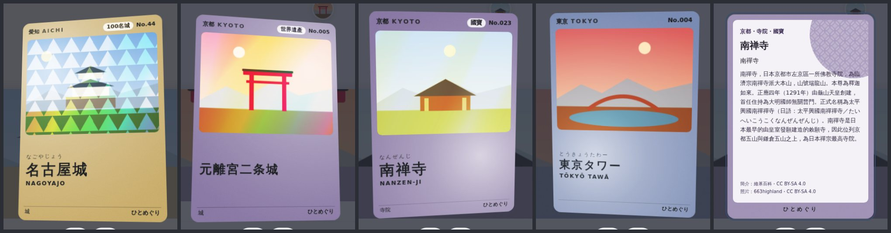

### 2. 收集冊（`/log/cards`）

去過的景點（自己標的＋已結束行程裡的停留點）全部做成卡片，依縣排列。

- 上方：張數、去過的都道府縣（右側日本地圖，第二輪）、名城進度（去過幾座 / 197）。
- 篩選：全部／世界遺產／名城／國寶・特別史跡・特別名勝。
- 卡片依序從下方翻上來（像發牌）；滑鼠移到卡片上會傾斜。
- 點卡片放大：← → 或左右滑換上一張、下一張，「地圖」回到那個景點，Esc 關閉。
- 入口：紀錄頁最上方，最近去過的三張卡疊成扇形，滑過時展開。

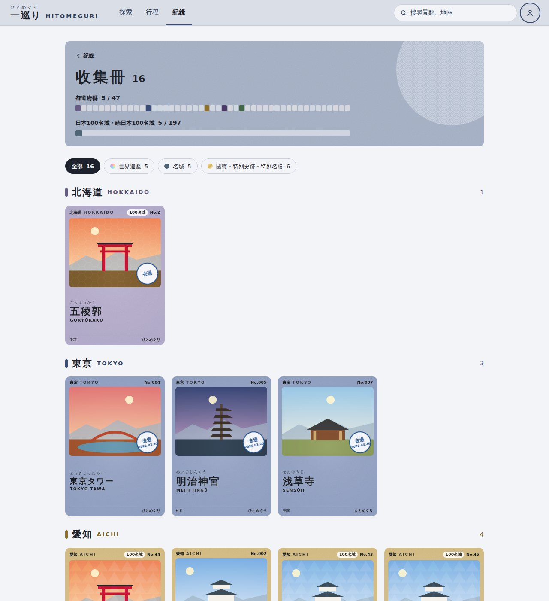

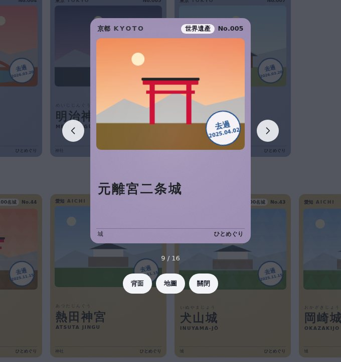 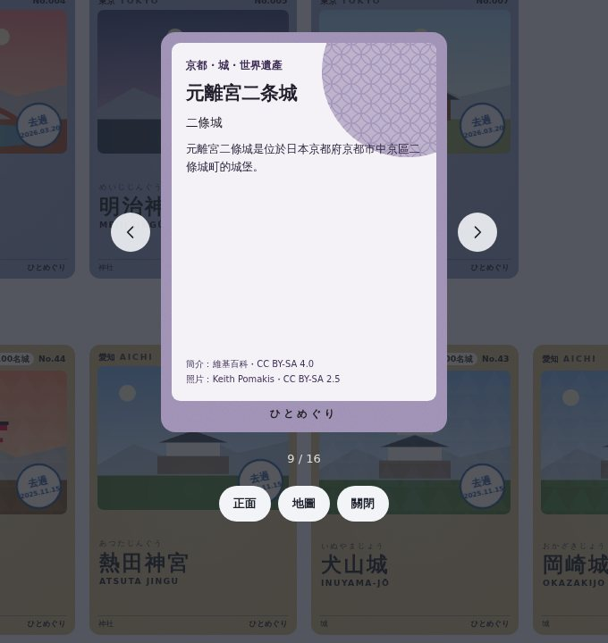

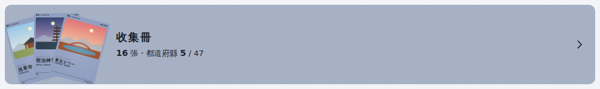

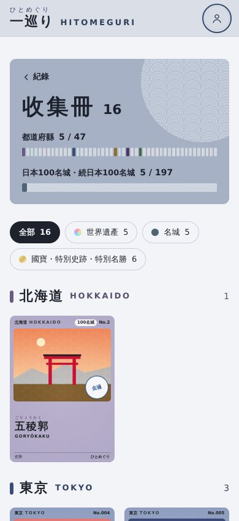

效能：收集冊只用各縣的地圖 bundle（每縣約 30 KB）就畫得出卡面與稀有度；為此 map bundle 多一個欄位 `d`（最高的文化指定：世界遺產 213、國寶 121、特別史跡 41、特別名勝 18，共 393 處）。放大檢視時才載入該縣的詳細資料換上簡介。

### 3. 開場動畫

原本的「圓弧繞圈＋進度條」改成 47 都道府縣的圓點圍成一圈：北海道在最上面，順時針到沖繩。載入進度走到哪一縣，那一縣的圓點就亮成該縣的地區色，一次亮一顆。全部亮完後圓點往外擴散，從中間開一個洞露出網站。

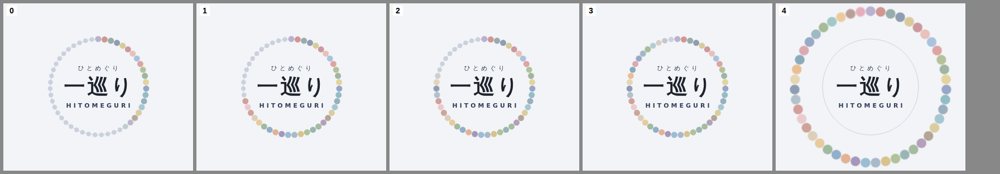

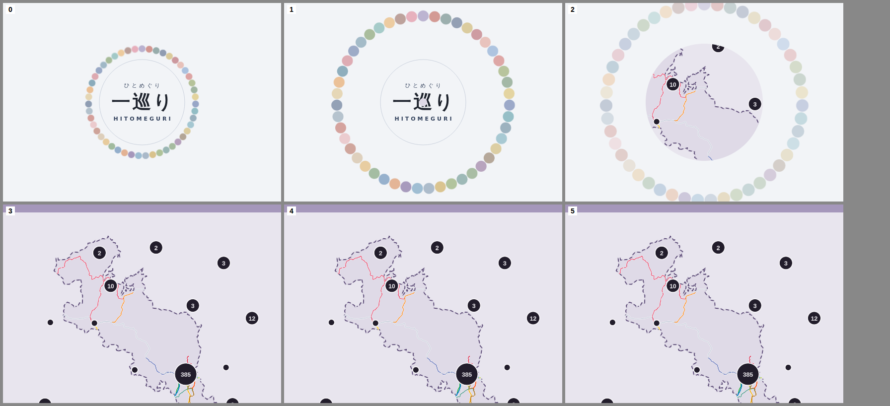

### 4. 操作過渡

- **換頁過場**：地圖頁左上的地區標籤點「深度探索」後，會長成深度探索頁的標頭（色塊、縣名、紋樣圓一起移動放大），按「地圖」返回時縮回去。其他換頁是整頁淡入淡出；同一頁裡選景點、換縣不做。

  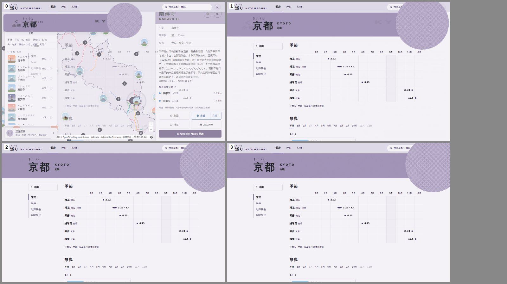

- **去過的蓋章**：按「去過」時勾勾像印章壓下去、擴出一圈墨暈（景點卡片、清單列的快捷鈕）。只有自己按下時播放。

  

- **滑動的選中標示**：頂部分頁（探索／行程／紀錄）的底線、手機底部分頁、深度探索與旅前準備的段落目錄，選中的標示會滑到新的位置，不再用跳的。
- **景點卡片**：換景點時內容淡入；手機的卡片從下方升上來；載入中改成照片、名稱、按鈕的灰色佔位。

  

- **收藏的星星**：按「收藏」時星星轉一下彈出來（只有自己按下時）。
- **選單淡入**：帳號選單、擴充包設定、日期選擇、搜尋結果、加入清單／行程的選單打開時淡入，不再突然出現。
- **行程排序**：行程編輯頁用「往前／往後」、拖曳或換天時，停留點滑到新的位置。
- **數字滾動**：擴充包件數、收藏數、收集冊的張數，改變時每一位數像里程表滾到新的數字。
- **載入中**：其他頁面的「載入中」文字都換成灰色佔位列（搜尋、擴充包清單、收藏、旅前準備、練習、旅前小書、行程、共編邀請）。

系統設定「減少動態」時，以上全部關掉（只保留淡出）。

### 5. 第二輪（2026-10-01）

你決定拿掉 DESIGN.md「動畫 ≤ 250ms、不做彈跳縮放、不用漸層」的限制，改成「有理由才動、不擋操作、尊重減少動態」（DESIGN.md §1 第 7 條、§9、§12）。這一輪加了：

#### 新卡入手

在景點卡片按「去過」：畫面暗下，收集卡從下方轉兩圈飛到中央，落定時背後放光（虹卡虹色、金卡金色、名城是縣色、一般白光，慢慢旋轉）、一圈光往外擴、蓋上去過的印章、一道光掃過卡面，手機輕震一下。停兩秒左右（越稀有越久）後縮小飛進「紀錄」分頁，分頁跳一下。點任何地方或 Esc 直接收進去。清單列的快捷鈕不播（一次標很多個時會太吵）。

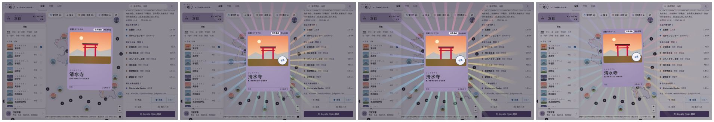

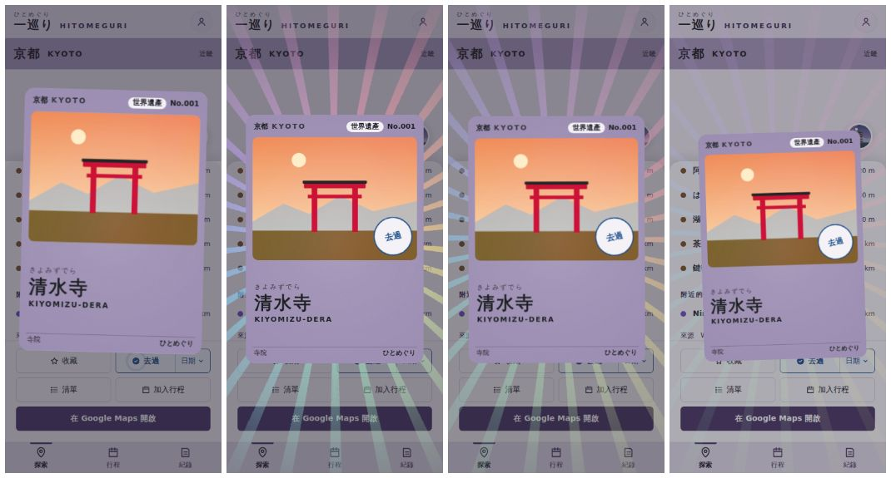

#### 季節飄落

深度探索頁與收集冊的海報區飄櫻花瓣、紅葉、銀杏、雪或螢火蟲。季節先看氣象廳本季觀測（這個縣正在開花或轉紅、轉黃），沒有時依月份：3–4 月櫻花、6–7 月螢火蟲、10–11 月紅葉、12–2 月雪（北海道、沖繩另外算）。葉片會翻面、左右飄；滑鼠經過時被風吹開。網址後面加 `?season=sakura`（`momiji`、`ichou`、`snow`、`hotaru`）可以預覽其他季節，例：`/region/kyoto?season=snow`。

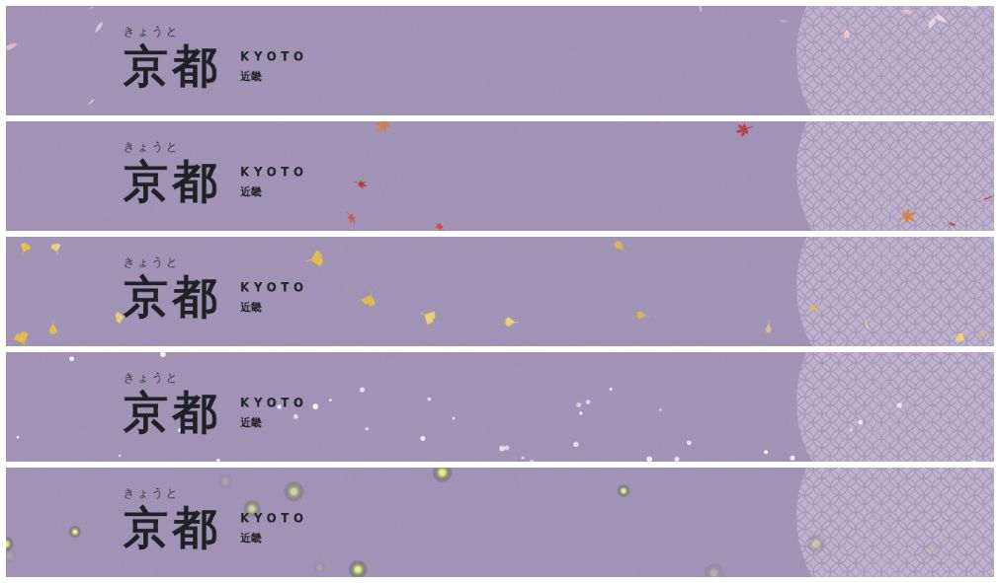

#### 收集冊的日本地圖

收集冊海報區右側換成日本地圖（取代原本的 47 格）：去過的縣塗該縣的顏色，進頁面時依北到南一縣一縣蓋上去（放大壓下、回彈）。滑過顯示縣名與張數，點去過的縣捲到那一縣的卡片。沖繩依日本地圖的慣例放在左上的虛線框裡。

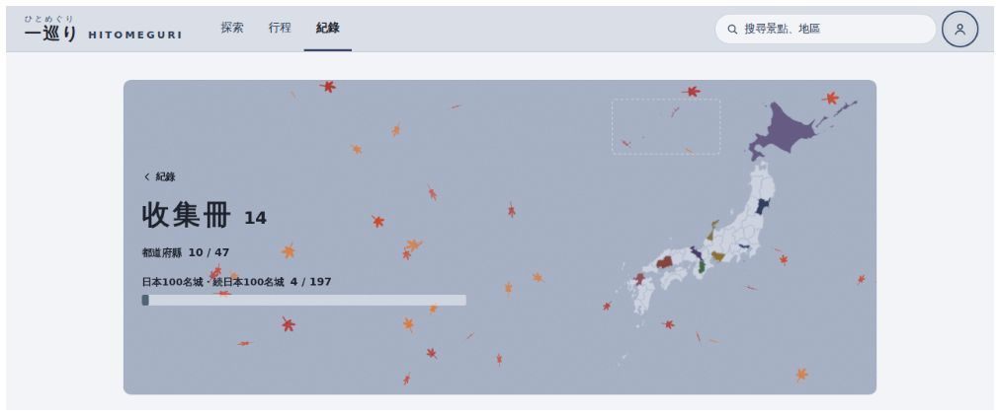 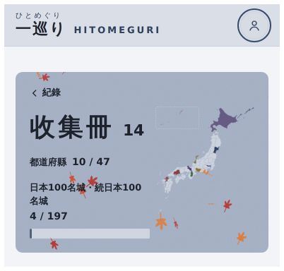

#### 行程路線像用筆畫出來

行程頁的路線在開頁、換天、排序時從起點畫到終點（前後慢、中間快），筆尖是一個圓點。

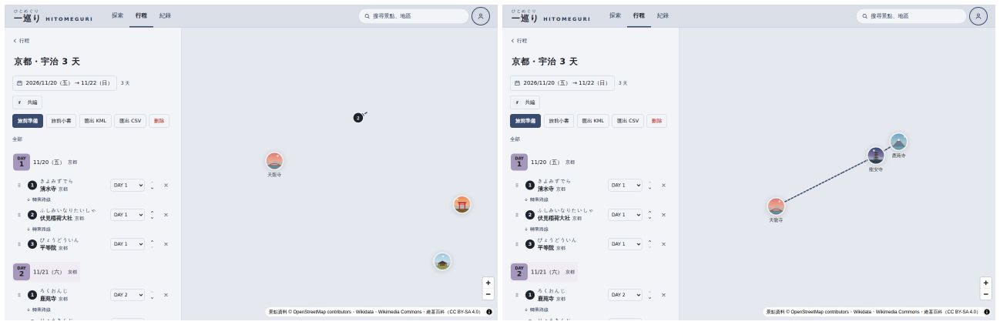

### 6. 待確認

- ~~§9 動態、§12 漸層~~：你決定拿掉限制（2026-10-01），DESIGN.md 已改。
- ~~合併方式~~：整個合併進 `main`（2026-10-02）。
- **新卡入手的長度**：現在停 1.9～2.6 秒，要更短或只在稀有卡播，跟我說。
- **新的顏色 token**：箔片（虹、金）與季節飄落（櫻、紅葉、銀杏、雪、螢火蟲）是固定色，不跟地區色走。

### 7. 已知限制

- 換頁過場用 View Transitions API：Chrome、Edge、Safari 18 以上有；不支援的瀏覽器照常換頁，沒有過場。
- iPhone 的「用手機傾斜」第一次要允許動作與方向的權限。
- 收集冊的格子裡照片沒有標作者（卡片背面、頁尾有註明）；地圖上的小照片原本也是這樣。
- 擴充包的點（人孔蓋、老舖、角色商店）不做成卡片；名城進度算得到。

### 8. 第四輪（2026-10-02）

- **位置小框**改到左側面板右邊（和「深度探索」底部對齊），不能點，只顯示：日本全圖、目前範圍的框、下方縣名與放大倍率（「長野 ×8.2」，以日本全圖為 ×1）。

  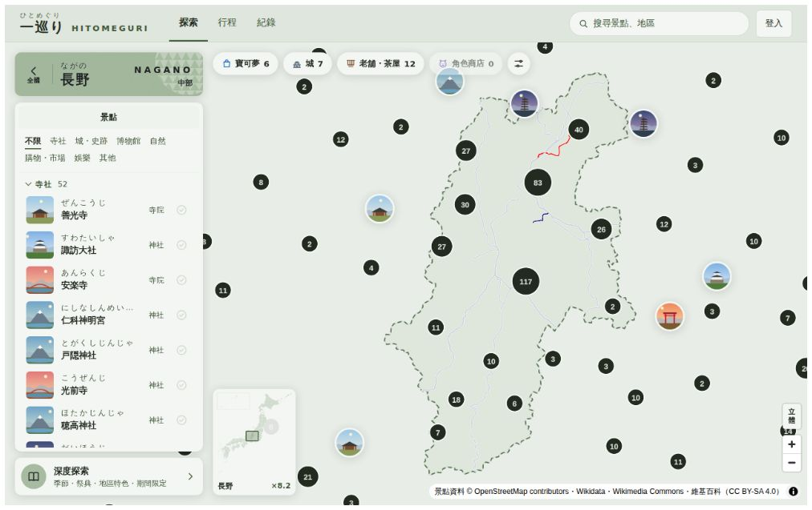

- （2026-10-10 立體地形已移除，使用者決定）**立體**只開關地形與陰影，不再自動傾斜（傾斜照舊用右鍵拖曳、手機兩指上下拖）。陰影加深，正上方看也看得出山的起伏。地形資料涵蓋全日本（国土地理院 DEM10B，已確認瀏覽器可以直接讀取），山區放大、傾斜後最明顯，例如長野、富山的北阿爾卑斯、富士山。
- **出發倒數翻牌**：行程卡片與行程頁的「還有 N 天」，數字像車站發車標一格一格翻過去。

  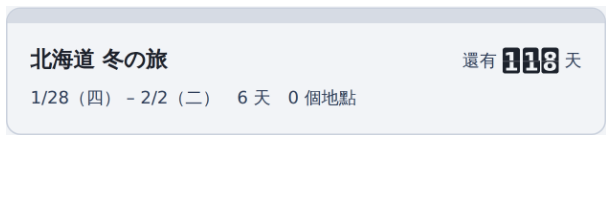

- **縣的紀念章**：在一個縣第一次按「去過」，新卡入手時卡片左下蓋上這個縣的紀念章（像車站的スタンプ：縣名、羅馬拼音、初訪、日期）。

  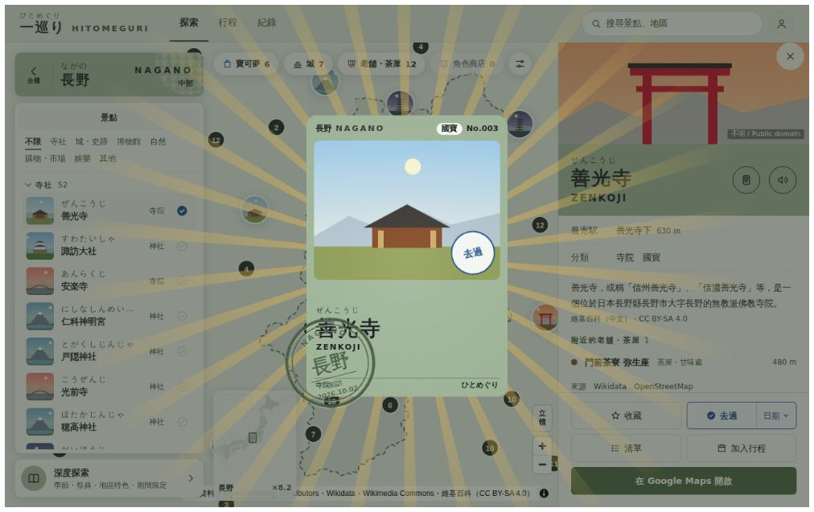

- **8 月的煙火**：深度探索頁與收集冊的海報區在 8 月放煙火（季節飄落的一種；`?season=hanabi` 可以預覽）。

  

- **景點照片慢慢拉近**：景點卡片上方的照片 14 秒緩緩拉近、平移。

### 9. 收集卡的樣式（2026-10-02）

同一個景點有好幾種卡，像寶可夢卡同一隻有基本卡、全圖卡、特別插畫卡（DESIGN.md §7.19a）。

- 每去過一次抽一次：自己標的去過日期、每一趟結束的行程的每一天各算一次。去得越多次，收集到的樣式越多。
- 樣式：
  - 基本。
  - 春景・夏景・秋景・冬景：看去的日期，卡框鋪櫻花、煙火、楓葉、雪花的紋樣。
  - 全景：照片鋪滿整張卡（20%）。
  - 金箔：整張金框（4%）。
  - 特別全景：世界遺產、國寶才有，全景＋整張虹色箔片（10%）。
- 抽到什麼由帳號、景點、日期決定，換裝置、重新整理都一樣，不能重抽。
- 收集冊顯示最稀有的那張，下方寫「3 / 8 種」；篩選多了「全景・金箔」。放大檢視下方可以切換收集到的每一種樣式。
- 新卡入手、開卡包會用這次抽到的樣式；抽到特別全景、金箔時背後的光是虹色、金色。

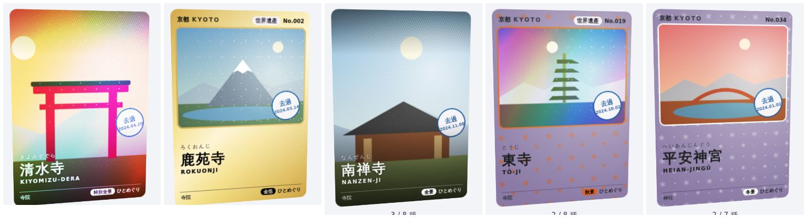

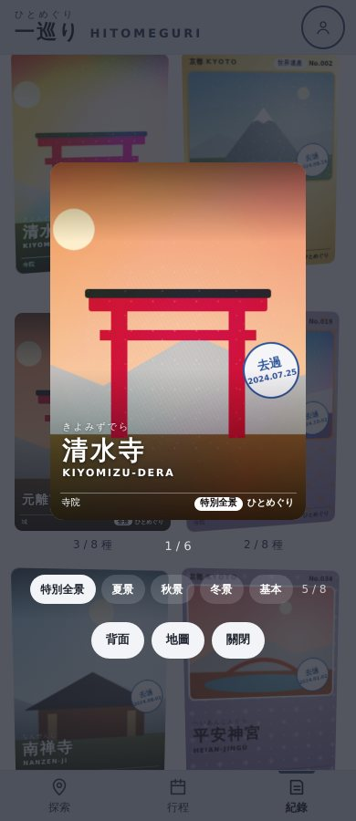

## 年代主題

（原「年代主題 驗收說明（2026-10-02）」）

規格見 DESIGN.md §13（各年代的顏色、字型、照片、形狀一覽表）；昭和的 mockup：https://claude.ai/artifact/ML2F8FTvJa9LDsKY263tXw

### 怎麼切換
- 登入後點右上頭像 →「年代」時間軸：拖曳把手或點年代名稱。江戶（1603–1868）、明治（1868–1912）、大正（1912–1926）、昭和（1926–1989）、平成（1989–2019）、令和（2019–，原本的樣子）。
- 選了就存在這台裝置；網址加 `?theme=showa`（edo、meiji、taisho、heisei、modern）也會切換並記住。
- 開場畫面、旅行回顧圖（分享圖）也跟著年代的顏色與字型。

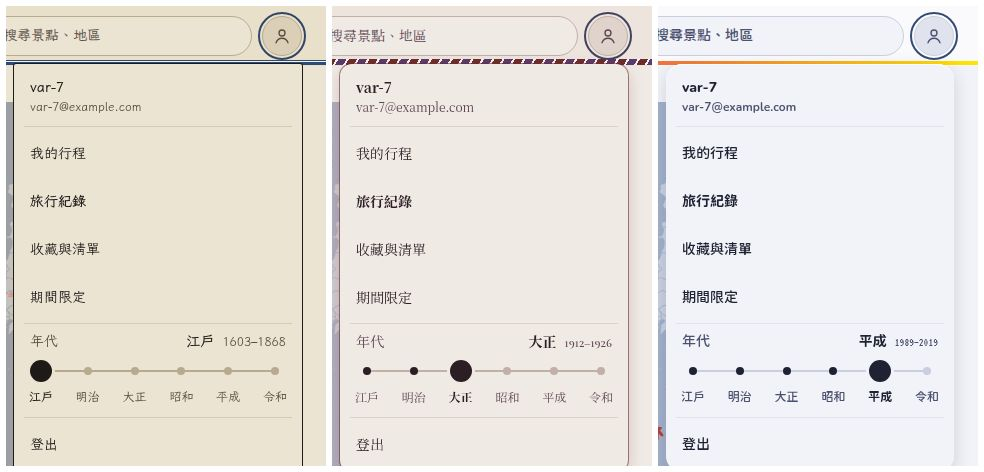

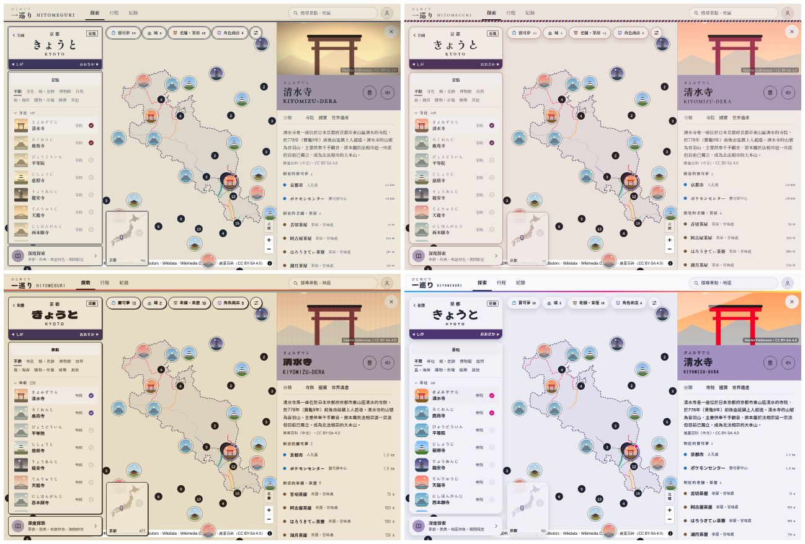

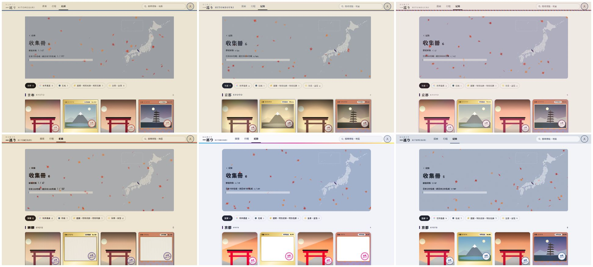

### 收集卡：無限抽、季節照片
- 測試期每次按「去過」、每次打開卡包都重抽一次；放大檢視多了「再抽一張」。抽到的存在帳號裡（Firestore `users/{uid}/cards`，規則請貼到 Console；沒貼之前只存在這台裝置）。
- 全景、金箔、特別全景、季節卡改用抽到那個季節的照片（Commons 分類裡有的話），卡片背面的出處跟著換。季節照片由 Actions 的 `seed-pack` → `seed-season-photos` 找（分數 70 以上、有 Wikidata 的景點）。2026-10-02 跑完全部縣（run #50）：查了 3,125 筆，627 筆找到，其中夜景 236、春 221、冬 145、秋 137、夏 39；東京 110、北海道 76、京都 62 最多，高知 0。照片來自景點本身的 Commons 分類，少數是分類裡的周邊照片（例如萬松寺的夏景是大須夏祭）。

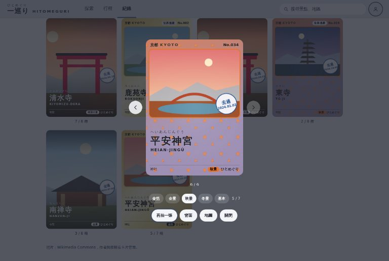

### 新卡種、十連抽
- 樣式從 7 種變 11 種（稀有景點 12 種）：多了夜景、墨繪、切手、銀箔。機率在 DESIGN.md §7.19a。
- 放大檢視：「再抽一張」（新卡入手動畫）、「十連抽」（十張一次排成 5×2，依序自動翻開，也可以「全部翻開」；翻開的點一下放大）。
- 收集冊的封面：放大檢視收集到兩種以上時可以「設為收集冊的封面」；沒選的顯示基本卡。
- 測試期的抽卡季節也隨機，才抽得到夏景、冬景（正式規則看去的日期）。
- 原生 `<select>` 都換成自己的下拉選單（行程的「移到 DAY n」、加入行程的天、收藏的行程）；品牌欄的建議改成膠囊。
- 景點照片的慢慢拉近拿掉；位置小框的擴散光圈拿掉。
- 地圖照片圓點對不準：改用資料的座標（原本用圖磚回傳的幾何）。

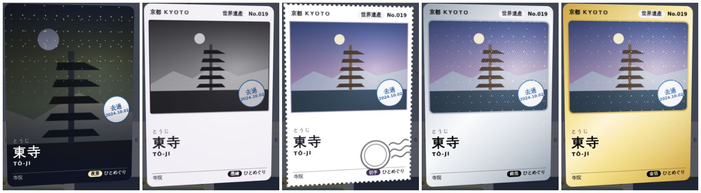

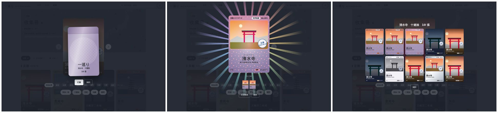

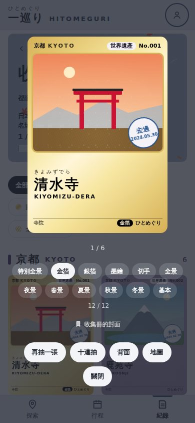

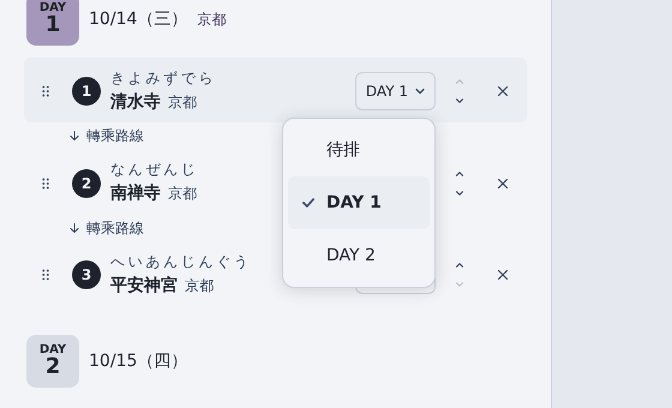

### 這次一起修的
- 切換時 header 高度不變（帶色畫在 header 裡面），不再抖一下。
- 大標的中文改用有繁體字的字型（日文字型缺字時，一句裡會混兩種字）。
- 地圖最大放大到 17 級（原本可以一直放大；底圖圖磚只到 14 級）。
- 地圖上的照片圓點、收集卡的陰影減輕。
- 擴充包面板「在 Google Maps 開啟」放不下時換到下一行。
- 季節卡（春景…）在淡色的縣也看得出來：卡框上半染季節色，花樣加影子，傾斜時跟著光源飄。
- 選取景點時往外擴散淡出的光圈拿掉，只留一圈。
- 川越的「氷川神社」改成正式名稱「川越氷川神社」（埼玉有三間同名的氷川神社：川越、大宮、浦和）。

### 請確認
- 各年代的感覺、字型。
- 站名標「前後一個縣」要不要留。

## 離線、經縣值、分享圖、位置小框、景點整理（第三輪）

（原「第三輪驗收：離線、經縣值、分享圖、位置小框、特效、景點整理」）

完成日期：2026-10-02
網站：https://hitomeguri-7d87a.web.app/

你睡前交代的：離線、旅行回顧圖、經縣值地圖、四個特效（開卡包、3D 地形、更多箔片、換縣轉場）、特效分支合併回 main、修搜尋結果被地圖蓋住、查東京華納影城、篩掉地區型景點、地圖位置小框。全部都上線了，下面依序說明。

### 要你做的事

1. **Firestore 規則**：經縣值要存在 `users/{uid}/meta/keiken`，規則加了一段（`firestore.rules` 的「經縣值」）。請把整份 `firestore.rules` 貼到 Firebase Console → Firestore → 規則 → 發布。發布前經縣值會先存在這台裝置，發布後下一次修改時同步上去。
2. **景點資料**：已合併。排除清單如果有不該排的，告訴我名稱。

### 1. 特效分支合併、搜尋結果

- 特效分支已經整個合併進 `main`，之後的特效直接在 `main` 做；分支與預覽網址的 workflow 刪掉了（預覽網址到期前還看得到舊版）。說明文件改名為 本文件「特效與收集卡」。
- **搜尋結果被地圖蓋住**：特效分支的換頁過場讓頂部列自成一層（`view-transition-name`），裡面的搜尋結果、帳號選單就疊不過地圖。頂部列加了層級，修好了。

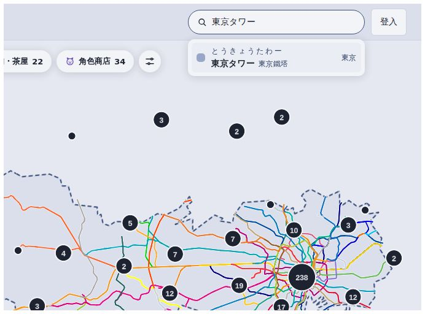

### 2. 東京的華納影城（ワーナー ブラザース スタジオツアー東京）

為什麼沒有：
- 東京的景點清單來自官方觀光網站 GO TOKYO。GO TOKYO 有列這一筆，但這一頁沒有地圖座標，只能靠「名稱完全相同」對到 Wikidata 或 OSM 的候選。
- GO TOKYO 的名稱是「ワーナー ブラザース スタジオツアー東京 – メイキング・オブ・ハリー・ポッター」，後面多了副標題。
- Wikidata 上這個項目（Q117148543）沒有日文標籤，只有別名「スタジオツアー東京」，所以兩邊都對不上。
- 它的位置原本是としまえん（2020 年關閉）；資料裡還留著としまえん。

怎麼修：
- 官方名稱比對時拆開「–」後面的副標題。
- 種子清單（`data/seed/seed_from_guides.json`）可以直接指定 Wikidata 項目。加了這一筆（標成你要求的 `user-request-2026-10`），日文名用種子寫的。
- Wikidata 有關閉日的設施排除（としまえん），規則見下一節。
- 東京重新採集（seed-region run 32），結果見「景點整理」。

### 3. 景點整理：地區、事件、已關閉

你說淺草、新宿、中目黑這類是地區不是景點。查了 Wikidata 的類型（P31），新增規則：

| 規則 | 例子 |
|---|---|
| 類型「全部」都是地區類（町丁、都市の地区、広域地名、繁華街、歓楽街、電気街、都心等拠点地区、歴史的地域、大字…）就排除；另有景點類型的保留 | 排除：浅草、新宿、銀座、秋葉原、渋谷、六本木、歌舞伎町、道頓堀、心斎橋、みなとみらい、嵯峨野。保留：嵐山（山）、アメ横（商店街） |
| 地區類但名稱以跡、通り、横丁、小路、町並み結尾，或有文化指定（重要伝統的建造物群保存地区等）的保留 | 長町武家屋敷跡、上通・下通（商店街） |
| 東京 23 區本身（「日本の特別区」，原本的規則漏了這個寫法） | 新宿区、渋谷区等 16 區 |
| 事件（大量殺人、暗殺…） | 秋葉原通り魔事件、桜田門外の変 |
| 已關閉：Wikidata 有廢止日或關閉日、而且在 1950 年以後、沒有文化指定、類型不是遺構、遺跡、城、廢礦、橋 | としまえん、築地市場、スペースワールド、梅小路蒸気機関車館、合併掉的町村。保留：熊本城、岐阜城（江戶明治的「廢止」）、富岡製糸場、タウシュベツ橋梁、別子銅山 |
| 拆除的建築（不是城跡的） | 凌雲閣 |

規則調了三次才對：第一次把江戶時代廢城的城（熊本城）、文化遺產（富岡製糸場）、商店街（上通）、廢橋（タウシュベツ橋梁）都排掉了，看了報告後逐一修正。每次的排除清單在 `pipeline/prune-spots-*` 分支的 commit 訊息。

**合併狀態（已合併進 main）**：全國排除 274 筆（地區、23 區、事件、已關閉、拆除）。東京改用重新採集的結果（seed-region run 32）：401 個景點，去掉 41 筆（浅草、新宿、銀座、秋葉原、渋谷、六本木、歌舞伎町、23 區、としまえん、築地市場、秋葉原通り魔事件…），補進 47 筆（含ワーナー ブラザース スタジオツアー東京、チームラボプラネッツ、渋谷ヒカリエ、柴又帝釈天、皇居東御苑）。各縣排除清單在 `pipeline/prune-spots-48` 的 commit 訊息。補進來的有幾筆不太像景點（東京湾岸警察署、電通本社ビル、工學院大學），看到可以告訴我加進排除清單。

### 4. 地圖位置小框

放大到看不出在哪裡時（縮放 6.5 以上），出現日本全圖（後來改到桌機左側面板右邊、手機清單或景點卡片的左緣，見 DESIGN.md §8）：目前的縣塗地區色，看的範圍畫成框（太小時是一個點）。沖繩照日本地圖的慣例放在左上的框。小框只顯示，不能點（設計如此）。

### 5. 離線

- 網站變成 PWA：看過的頁面、資料、地圖、照片會存在手機裡，沒網路也打得開。手機瀏覽器可以「加到主畫面」當 App 用。
- 收藏、去過、行程存在本機，離線也看得到；離線時的修改連上網後自動送出。
- 行程頁新增「離線用」：一次把這趟的資料、照片、停留點附近的地圖（縮放 10–15）與縣全圖下載好。出發前按一下。
- 沒網路時頂部顯示「離線」。有新版本時底部提示「有新版本　重新整理」，按了才換。

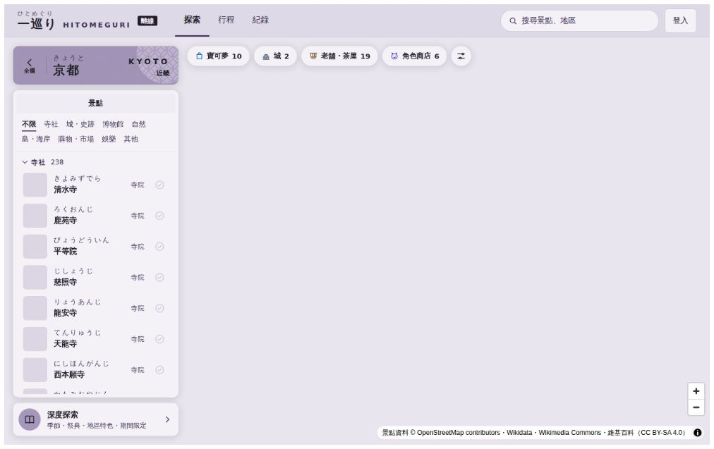

已知限制：地圖文字（字型）只有看過的區域才有存；第一次就離線打開沒看過的地方，地圖會是空白的。

### 6. 經縣值（`/log/keiken`）

日本的「経県値」玩法：每個縣選住過 5、過夜 4、玩過 3、踏上 2、路過 1、未踏 0，總分最高 235。

- 上方總分、各級數的縣數、「存成圖片」；中間日本地圖依級數塗色，點縣直接選；下方 47 縣列表，一排 6 個按鈕。
- 沒選的縣，有去過的景點就自動算「玩過」（虛線框），可以改。
- 入口：紀錄頁收集冊旁邊。

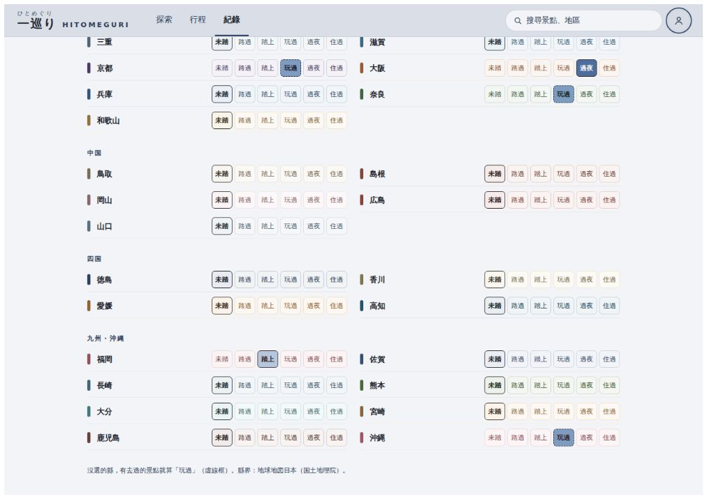

### 7. 分享圖（旅行回顧、經縣值）

- 行程頁「回顧圖」：行程名、日期、天數；停留點範圍的地圖（縣界）、每天的路線與順序、右上日本全圖；每天的停留點。
- 經縣值「存成圖片」。
- 1080×1350（IG 直式），電腦下載 PNG，手機可以直接分享。只畫自己的地圖與文字，不放照片（Commons 照片要逐張標作者與授權，分享出去容易漏）。

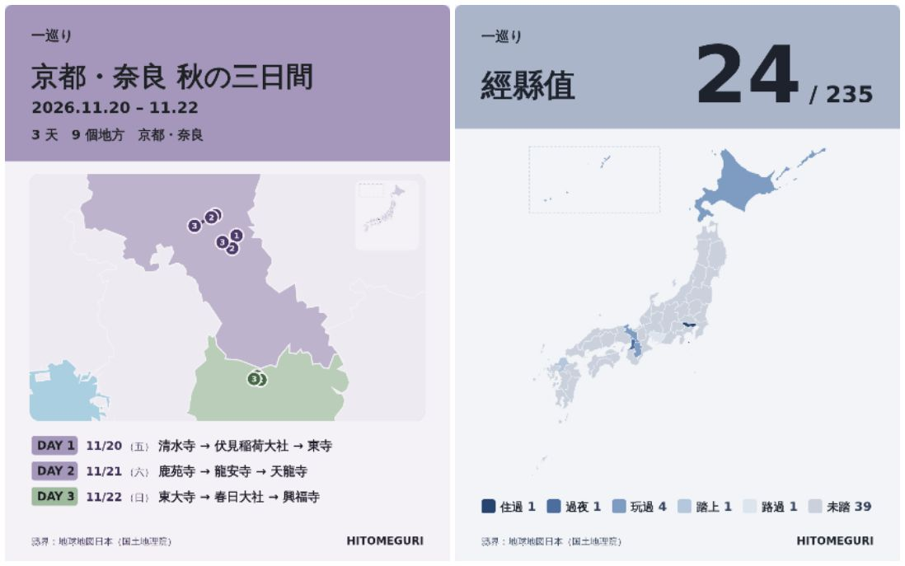

### 8. 特效

- **開卡包**：結束的行程在行程頁有「開卡包」（還沒開過的有紅點）。這趟去過的地方包成一包，點了撕開，卡片一張一張翻（一般的先、最稀有的最後；稀有卡背後放光），翻完一覽。

  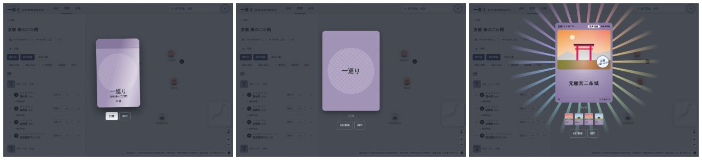

- **更多箔片**：世界遺產＝虹＋亮片、國寶＝金＋亮片、特別史跡・特別名勝＝反向閃卡（卡框發亮，照片不加）。

  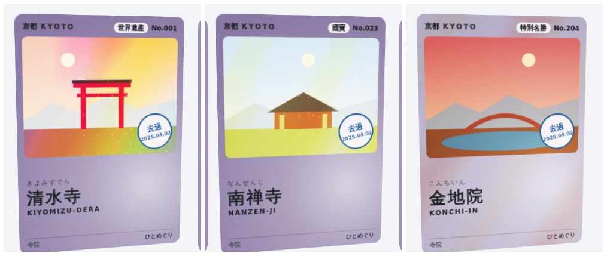

- **換縣墨暈**：點縣名、地區標籤、「全國」換縣時，新的地區色從點的地方像墨水暈開。拖地圖跨縣不會觸發。

  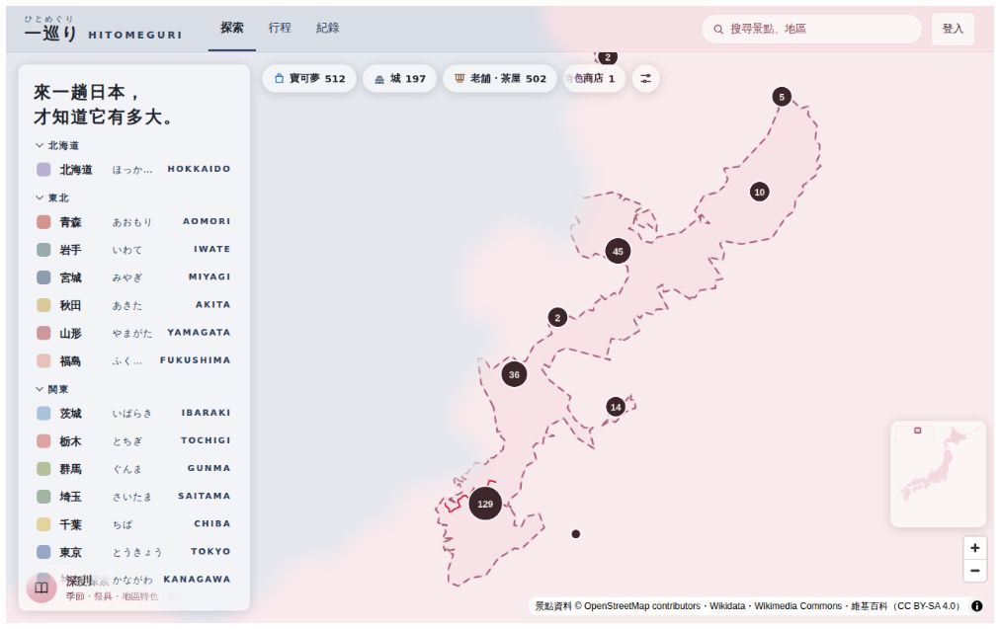

- ~~**立體地形**~~：已移除（2026-10-10，使用者決定）。

### 請你驗收

- [ ] 貼上 Firestore 規則後，經縣值選幾個縣，換一台裝置看是否同步
- [ ] 手機：加到主畫面、開飛航模式打開看過的縣
- [ ] 行程「離線用」、「回顧圖」、結束的行程「開卡包」
- [ ] 換縣的墨暈、位置小框
- [ ] 東京沒有淺草、新宿這類地區；有華納影城
- [ ] 景點排除清單（各縣）有沒有不該排除的

## 旅人（紙娃娃）與抽獎

（原「旅人（紙娃娃）與抽獎 驗收說明（第三版，2026-10-02）」）

規格見 DESIGN.md §7.19b（抽獎券與抽獎）、§7.24（旅人）。入口在「紀錄」頁的第三張卡、帳號選單最上面的旅人小窗，或直接開 `/log/avatar`。

### 這次改了什麼
回饋：風格、比例 OK；舞台不需要；扭蛋機不錯；服裝太少，每個縣至少 2–3 件；扭蛋不要重複；旅人在網站上多一點存在感；抽獎（旅人、景點卡）都不重複、收齊就不給抽、新的標 NEW；想清楚抽獎的辦法：不可能一直去同一個景點，也不該靠新增刪除行程刷卡包。

#### 抽獎的辦法
- 一種抽獎券，旅人扭蛋與景點卡共用。全部由「現在去過的地方」算出來：
  - 每個去過的景點 1 張、每個去過的縣 3 張、每個去過的地方（北海道、東北…8 個）5 張、景點每累積 10 個再 5 張。
  - 取消去過再勾回去、新增刪除行程，張數都不會變多；上限就是去過的地方。
- 景點卡：去過就有基本卡，加上去的那天的季節卡；每個景點第一次去過時送一次免費抽（在景點按「去過」或打開行程卡包，只送一次）。其他樣式用券抽，一定是那個景點還沒有的。
  - 放大檢視「抽一張」：1 張券，抽這個景點。
  - 收集冊上方「十連抽」：10 張券，從所有還沒收齊的景點裡抽 10 種還沒有的。不用一直去同一個景點，去過的地方越多，能抽的越多。
  - 收齊了按鈕變「已收齊」；剩不到 10 種時寫「抽 n 張」。
- 旅人扭蛋：1 張券，只抽還沒有的服裝；範圍是不限縣的＋去過的縣的，抽完寫「去過的縣都抽齊了」，去新的縣會加進新的。
- 旅人十連抽（2026-10-12 使用者要求）：10 張券、10 件不同的；抽獎券不到 10 張、或扭蛋裡剩不到 10 件時按鈕停用。十顆扭蛋排成 5×2（手機 4 欄）依序打開，「全部打開」一次開完；開了的點一下穿上。測試期（`UNLIMITED_DRAWS`）不看張數，只看剩幾件。
- NEW：新拿到、還沒看過的卡片樣式與服裝標「NEW」（照 UI 文案規則不加驚嘆號），看過、點過就拿掉。
- 收集冊上方點「抽獎券 n」會展開來源明細（景點、縣、地方、每 10 個景點、用掉）。
- 測試期照樣不限次數（券不夠也能抽），張數照算照扣，方便看機制。

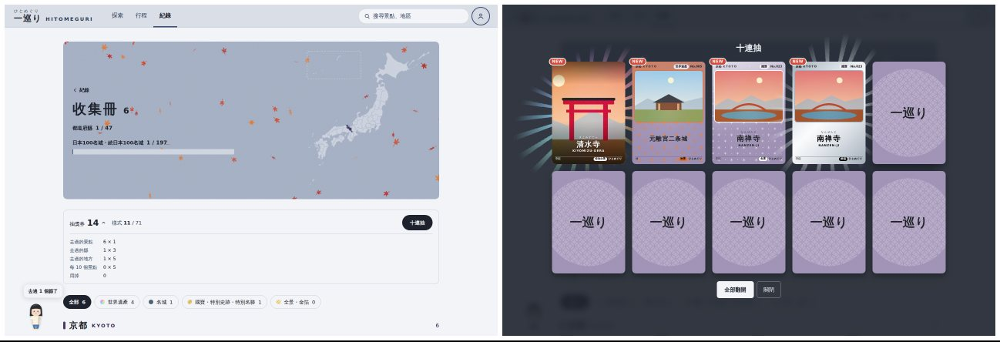

#### 旅人的服裝：478 件
（2026-10-09 加成就服裝 6 件，見 本文件「成就」「成就服裝」。2026-10-12 加不限縣的 46 件，見下面「不限縣的第二批」；同一天再加和風 34 件與 12 個縣的傳統服裝，見「和風與各縣傳統服裝」；再加其他 35 個縣各一件，見「其他 35 個縣的傳統服裝」；再加各縣頭上、手上各一件，見「各縣頭上與手上的第二批」；再加一批，見「各縣頭上與手上的第三批」。）
- 每個縣 3 件，共 141 件，取自那個縣實際的特產、工藝、祭典：例如秋田的生剝鬼面・秋田犬・烤米棒，山形的花笠・櫻桃・天童將棋駒，福島的赤牛・喜多方拉麵・水蜜桃，京都的抹茶・伏見稻荷狐面・舞妓花簪，德島的阿波舞編笠・酢橘・阿波舞浴衣，鹿兒島的白熊刨冰・櫻島大根・櫻島火山帽。
- 第一件是代表單品，第一次去那個縣就送；另外兩件去過那個縣之後加進扭蛋。
- 不限縣的 96 件用抽的（原本 16 件＋第二批 46 件＋和風 34 件）。
- 衣櫃有「只看有的」，有的排前面。

##### 不限縣的第二批（2026-10-12，46 件）
回饋：衣服太少，多一些不用去特定縣市的。全部用抽獎券抽，3D 展示窗也都穿得上。
- 衣服 19：橫條紋 T 恤、帽 T、格紋襯衫、針織毛衣、牛仔外套、羽絨外套、風衣、吊帶褲、運動服、立領學生服、水手服、連身裙、西裝、甚平、振袖、袴、旅館浴衣、雨衣、登山外套。
- 頭上 7：毛帽、漁夫帽、草帽、貓耳髮箍、蝴蝶結、耳罩、通學帽（草帽、漁夫帽、通學帽、毛帽在 3D 是轉一圈的圓帽）。
- 臉上 6：口罩、黑框眼鏡、OK 繃、愛心墨鏡、八字鬍（髮色）、星星貼紙。
- 手上 9：行李箱、旅遊地圖、飯糰、彈珠汽水、鯛魚燒、透明傘、車站便當、霜淇淋、紙鶴。
- 夥伴 5：柴犬、三花貓、晴天娃娃、雪人、金魚缸。
- 振袖、袴最稀有（3）；外套、制服、和服類與幾件小物少見（2）；其他常見（1）。

##### 和風與各縣傳統服裝（2026-10-12，46 件）
回饋：再一批日本元素的服飾或地區限定。
- 不限縣的和風 34 件，用抽獎券抽：
  - 衣服 12：巫女服、羽織袴、割烹著、半纏、小紋和服、書生服、劍道服、柔道服、弓道服、鳶職服、板前服、站務員制服。
  - 頭上 5：捻鉢卷、手拭頭巾、站務員帽、鬼角髮箍、櫻花髮夾。
  - 臉上 2：阿龜面、般若面（斜戴在頭側）。
  - 手上 10：三色糰子、羽子板、劍玉、風車、線香花火、蘋果糖、握壽司、御守、繪馬、竹蜻蜓。
  - 夥伴 5：狛犬、鯉魚旗、張子老虎、獅子舞、丹頂鶴。
- 各縣限定的傳統服裝 12 件：去過那個縣之後加進扭蛋（縣名小牌照舊）。
  - 青森 睡魔祭跳人浴衣、秋田 西馬音內端縫衣裳、宮城 雀舞法被、東京 町火消半纏、新潟 小千谷縮、富山 風之盆浴衣、愛知 有松絞浴衣、京都 舞妓和服、和歌山 熊野古道壺裝束、福岡 久留米絣、鹿兒島 大島紬和服、沖繩 紅型琉裝。
  - 題材是那個縣實際的祭典與工藝（網站資料裡的祭典與特產，與經濟產業大臣指定的傳統工藝品）。

##### 其他 35 個縣的傳統服裝（2026-10-12）
回饋：其他縣也各加一件傳統服裝。47 縣現在各 4 件（代表單品 1 件、扭蛋 3 件，其中一件是傳統服裝）。
- 北海道 二風谷厚司織、岩手 藤原祭狩衣、山形 置賜紬、福島 白虎隊裝束、茨城 結城紬、栃木 日光山伏裝束、群馬 伊勢崎銘仙、埼玉 秩父銘仙、千葉 萬祝大漁衣、神奈川 小田原北條鎧、山梨 富士講行衣、長野 信州紬、岐阜 鵜匠腰蓑、靜岡 茶摘裝束、石川 饗之事裃、福井 永平寺雲水衣、三重 斎王十二單、滋賀 近江上布、大阪 浪華本染浴衣、兵庫 赤穗義士裝束、奈良 天平衣裝、鳥取 弓浜絣、島根 石見神樂衣裳、岡山 桃太郎陣羽織、廣島 西條酒藏前掛、山口 先帝祭上臈打掛、德島 阿波藍縐織、香川 保多織、愛媛 八鹿踊衣裳、高知 龍馬紋付袴、佐賀 佐賀錦、長崎 皇帝遊行龍袍、熊本 山鹿燈籠浴衣、大分 修正鬼會鬼裝束、宮崎 古墳時代衣褌。
- 題材取自網站資料裡的祭典（例：岩手 藤原まつり、福島 会津まつり、三重 斎王まつり、兵庫 赤穂義士祭、長崎 ランタンフェスティバル的皇帝遊行），經濟產業大臣指定的傳統工藝品（例：結城紬、秩父銘仙、近江上布、弓浜絣），與代表的景點、名物（例：日光修驗、長良川鵜飼、永平寺、平城宮跡、坂本龍馬）。
- 驗收：去過那個縣之後，扭蛋抽得到；衣櫃的「衣服」分頁裡，掛縣名小牌。

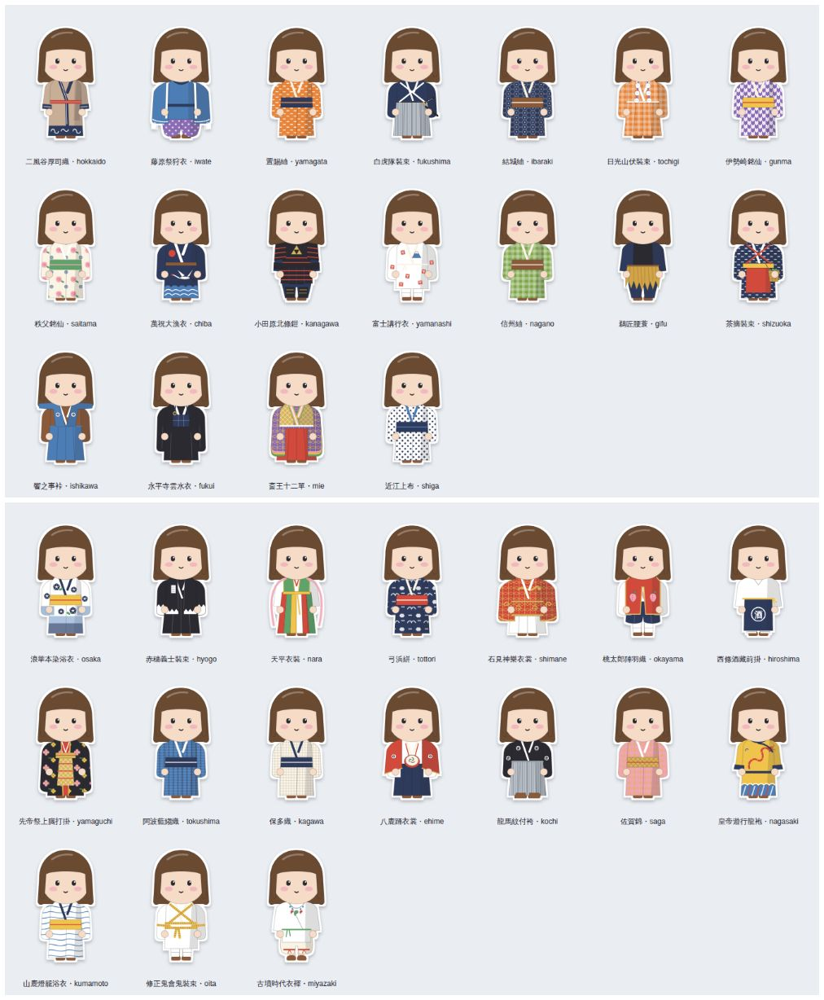

##### 各縣頭上與手上的第二批（2026-10-12，94 件）
回饋：頭上、手上也各縣多加幾件。47 縣現在各 6 件（代表單品 1 件、扭蛋 5 件）。
- 頭上：北海道 流冰天使髮夾、青森 睡魔武者燈帽、岩手 中尊寺金色堂帽、宮城 仙台七夕吹流、秋田 竿燈帽、山形 藏王樹冰帽、福島 起上小法師髮夾、茨城 黃門宗匠頭巾、栃木 日光眠貓髮夾、群馬 尾瀨水芭蕉髮飾、埼玉 川越時之鐘帽、千葉 大漁旗頭巾、東京 東京鐵塔帽、神奈川 明月院紫陽花髮飾、新潟 長岡煙火髮飾、富山 風之盆編笠、石川 加賀水引髮飾、福井 恐龍帽、山梨 桃花冠、長野 御柱帽、岐阜 白川鄉合掌屋帽、靜岡 濱松風箏髮飾、愛知 有松絞頭帶、三重 海女磯頭巾、滋賀 甲賀忍者頭巾、京都 葵祭葵葉髮飾、大阪 通天閣帽、兵庫 淡路島洋蔥帽、奈良 大佛螺髮帽、和歌山 熊野市女笠、鳥取 麒麟獅子頭、島根 泥鰍舞頰被、岡山 兒島丹寧帽、廣島 嚴島鳥居帽、山口 上臈花簪、德島 鳴門渦潮帽、香川 松盆栽帽、愛媛 宇和島牛鬼帽、高知 尾長雞髮飾、福岡 博多仁和加面、佐賀 熱氣球帽、長崎 長崎燈會燈籠髮飾、熊本 山鹿金燈籠、大分 香菇帽、宮崎 美豆良、鹿兒島 種子島火箭帽、沖繩 琉球花笠。
- 手上：北海道 烤玉米、青森 帆立貝燒味噌、岩手 南部鐵壺、宮城 笹蒲鉾、秋田 曲木便當盒、山形 玉蒟蒻、福島 大內宿蔥蕎麥、茨城 乾番薯、栃木 益子燒湯吞、群馬 烤饅頭、埼玉 狹山茶罐、千葉 房州枇杷、東京 江戶風鈴、神奈川 大涌谷黑玉子、新潟 片木蕎麥、富山 螢烏賊、石川 輪島塗碗、福井 羽二重餅、山梨 甲州水晶球、長野 信州烤餅、岐阜 岐阜燈籠、靜岡 山葵、愛知 名古屋手羽先、三重 伊賀組紐、滋賀 大津繪、京都 生八橋、大阪 串炸、兵庫 播州算盤、奈良 鹿仙貝、和歌山 紀州竹竿、鳥取 傘舞花傘、島根 泥鰍舞竹簍、岡山 備前燒德利、廣島 烤牡蠣、山口 萩燒茶碗、德島 阿波人形淨琉璃、香川 和三盆、愛媛 砥部燒碗、高知 土佐芋條、福岡 梅枝餅、佐賀 小城羊羹、長崎 角煮包、熊本 辛子蓮藕、大分 臭橙、宮崎 埴輪、鹿兒島 薩摩炸魚餅、沖繩 三線。
- 題材取自網站資料裡的祭典與郷土料理、經濟產業大臣指定的傳統工藝品（南部鐵器、輪島塗、備前燒、萩燒、砥部燒、播州算盤…）與代表的景點（東京鐵塔、嚴島神社、白川鄉、中尊寺…）。
- 頭上與臉上不疊在一起（同日回報）：斜戴的面具在頭的一側，髮簪、蝴蝶結、髮夾都戴在另一側；戴帽子、頭盔、頭帶時，面具在帽子上面，不會被蓋住。

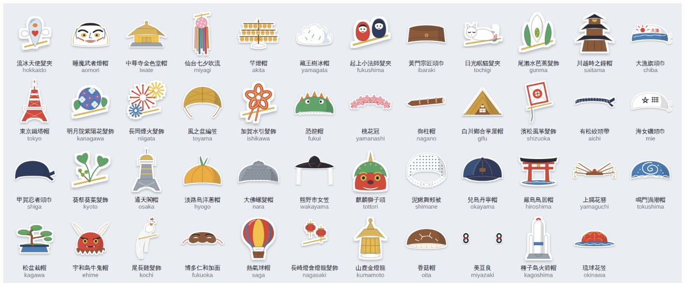

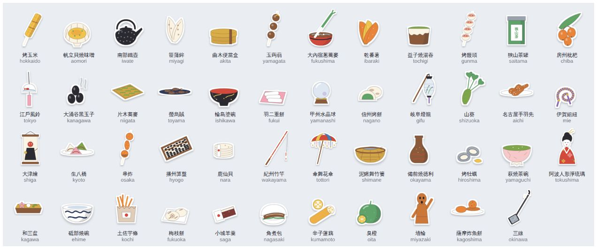

##### 各縣頭上與手上的第三批（2026-10-12，94 件）
回饋：每縣頭上、手上再各加一件。47 縣現在各 8 件（代表單品 1 件、扭蛋 7 件）。
- 頭上：北海道 愛奴刺繡頭帶、青森 小巾刺頭巾、岩手 恰古恰古馬髮夾、宮城 光之樂章髮箍、秋田 樺細工髮簪、山形 紅花髮飾、福島 三春瀧櫻髮飾、茨城 筑波山蟾蜍帽、栃木 日光陽明門帽、群馬 蠶繭髮飾、埼玉 古代蓮髮飾、千葉 犬吠埼燈塔帽、東京 神田祭神輿帽、神奈川 流鏑馬綾藺笠、新潟 朱鷺髮飾、富山 鬱金香髮飾、石川 兼六園雪吊帽、福井 雲水網代笠、山梨 葡萄藤冠、長野 真田六文錢頭帶、岐阜 高山祭屋台帽、靜岡 下田黑船帽、愛知 尾張七寶髮簪、三重 伊勢志摩珍珠髮飾、滋賀 琵琶湖小鸊鷉帽、京都 祇園祭長刀鉾帽、大阪 今宮戎福笹髮飾、兵庫 神戶港塔帽、奈良 五重塔帽、和歌山 圓月島帽、鳥取 砂丘駱駝帽、島根 出雲勾玉髮飾、岡山 岡山烏城帽、廣島 宮島紅葉髮飾、山口 錦帶橋帽、德島 阿波狸耳髮箍、香川 小豆島醬油桶帽、愛媛 道後溫泉本館帽、高知 土佐珊瑚髮簪、福岡 太宰府木鷽髮飾、佐賀 吉野里物見櫓帽、長崎 長崎傘鉾帽、熊本 肥後象嵌髮簪、大分 別府湯煙毛巾、宮崎 日向夏髮飾、鹿兒島 繩文杉帽、沖繩 扶桑花髮飾。
- 手上：北海道 奶油馬鈴薯、青森 八戶仙貝湯、岩手 盛岡冷麵、宮城 仙台牛舌、秋田 煙燻蘿蔔漬、山形 芋煮、福島 大堀相馬燒杯、茨城 笠間栗、栃木 日光湯波、群馬 下仁田蔥、埼玉 行田足袋、千葉 九十九里烤文蛤、東京 人形燒、神奈川 橫濱燒賣、新潟 柿種米果、富山 富山紙風船、石川 烤喉黑魚、福井 若狹塗筷、山梨 甲州印傳錢包、長野 野澤菜漬、岐阜 五平餅、靜岡 駿河竹蟲籠、愛知 手筒煙火、三重 萬古燒急須、滋賀 鮒壽司、京都 京都上生菓子、大阪 大阪豬肉包、兵庫 出石皿蕎麥、奈良 高山茶筅、和歌山 目張壽司、鳥取 砂丘蕗蕎、島根 出雲善哉、岡山 倉敷帆布包、廣島 熊野筆、山口 山口外郎、德島 竹竹輪、香川 丸龜團扇、愛媛 鯛魚飯、高知 帽子麵包、福岡 博多牛腸鍋、佐賀 佐賀丸芳露、長崎 長崎玻璃喇叭、熊本 八代晚白柚、大分 關鯖、宮崎 肉捲飯糰、鹿兒島 薩摩切子、沖繩 艾薩手鼓。
- 題材取自網站資料裡的祭典（高山祭、祇園祭、神田祭、長崎くんち、チャグチャグ馬コ、下田黑船祭、豐橋的手筒煙火）與郷土料理（せんべい汁、芋煮、いぶりがっこ、日光ゆば、五平餅、ふなずし、出石皿そば、めはり寿司、鯛めし…），經濟產業大臣指定的傳統工藝品（樺細工、大堀相馬燒、尾張七寶、甲州印傳、駿河竹千筋細工、萬古燒、高山茶筌、熊野筆、丸龜團扇、肥後象嵌），與代表的景點（日光陽明門、犬吠埼燈塔、兼六園、興福寺五重塔、圓月島、錦帶橋、道後溫泉本館、吉野里遺跡、屋久島繩文杉）。
- 驗收：去過那個縣之後，扭蛋抽得到；髮飾戴在頭的一側，不和斜戴的面具疊在一起；3D 展示窗都穿得上。

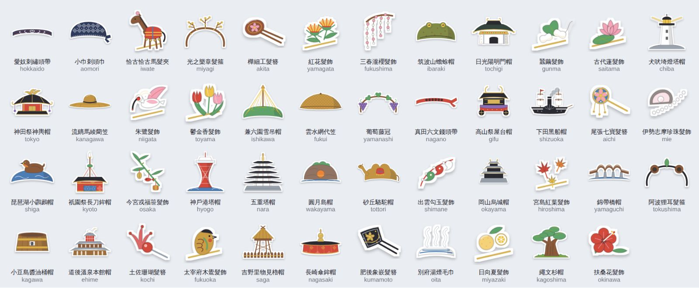

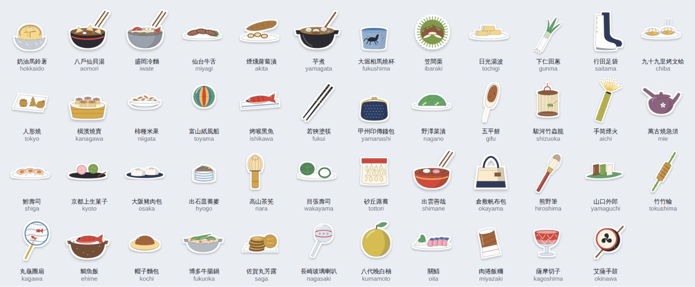

##### 3D：塔立在頭頂、帽子包住後腦、面具不變形（2026-10-13）
回饋：塔類的帽子不是尖在頭上；有些帽子只蓋到前額，後腦沒有；斜戴的面具在頭上會變形。
- 塔（東京鐵塔、通天閣、時之鐘、神戶港塔、犬吠埼燈塔、五重塔、種子島火箭、山鹿金燈籠）立在頭頂的正中間，轉到側面也是直的。2D 畫在瀏海上的那段塔腳收進頭裡，3D 正面看是塔從頭頂冒出來；海浪、岩座、屋簷這種畫滿的部分繞頭一圈。
- 頭巾、帽子、頭帶、城、神輿、屋台等：轉到側面、後面，後腦也蓋到；城的上層、神輿的鳳凰立在頭頂中間。
- 圓的笠與圓頂帽（風之盆編笠、熊野市女笠、流鏑馬綾藺笠、雲水網代笠、長崎傘鉾帽、哈密瓜帽、淡路島洋蔥帽、香菇帽、大佛螺髮帽）是真的一圈。
- 斜戴的面具是一片硬的，斜靠在頭側，不再跟著頭彎；戴帽子時在帽子前面。
- 犬吠埼燈塔拿掉光芒（2D 也拿掉）。

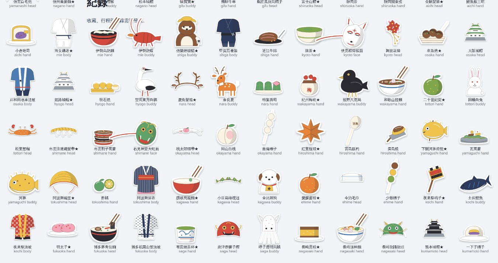

#### 旅人在網站上
- 滑鼠移到右上的帳號頭像：跳出旅人的小卡片（全身、服裝數、抽獎券），點了到旅人頁。
- 帳號選單最上面是旅人的半身小窗；選單裡多了「散步的旅人」開關。
- 散步的旅人（只在桌機，寬 1024 以上；手機不顯示，使用者決定）：登入後在畫面下緣走來走去，偶爾跳一下、轉一圈、鞠躬，或說一句話。說的話都來自自己的資料：下一趟出發倒數、目前地圖的縣（去過了、想去、去那裡可以拿到什麼）、剩幾張抽獎券、有沒穿的新衣服、收集冊有新的卡。點它會說一句。

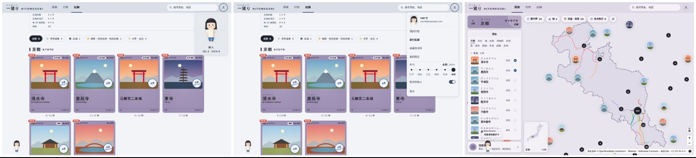

#### 規則
- 旅人頁標題旁「規則」：服裝怎麼拿、抽獎券怎麼算（附自己目前的張數明細）、衣櫃的記號、展示窗怎麼轉。自己點才打開。
- 收集冊的抽獎券那一條也有「規則」：卡片怎麼拿、各樣式、抽卡、抽獎券明細、收集冊的記號。
- 夜景卡只給找得到真的夜景照片的景點（目前 236 個）；不再拿白天照片調暗。其他景點每個 10 種樣式。

#### 外觀與清晰度（第四輪回饋）
- 髮型 5 → 13：加平頭、刺刺頭、旁分、捲髮、波浪長髮、雙丸子、雙馬尾、麻花辮。
- 眼睛 3 → 8：加豆豆眼、睫毛、鳳眼、睡眼、眨眼。膚色 3 → 6、髮色 5 → 9（金、灰、粉紅、藍）。
- 展示窗放大後配件粗糙：原因是待機時一直輕輕擺動，瀏覽器就用低解析度畫 3D 的層。拿掉待機擺動，停下來就用全解析度畫；轉動中仍會稍微模糊，放開就清楚。

#### 拿掉的
- 舞台的換縣與站名標。

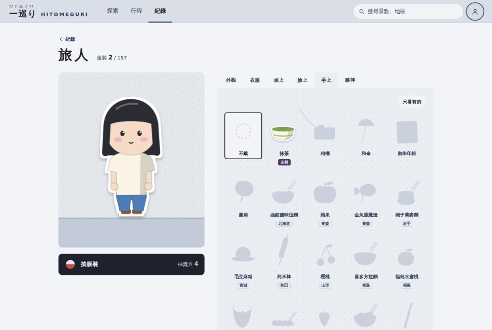

### 需要你處理
- `firestore.rules` 加了抽獎券（`users/{uid}/meta/wallet`），請再貼一次到 Firebase Console。沒貼之前抽獎券的用量只存在這台裝置。

### 請確認
- 抽獎券的張數（景點 1、縣 3、地方 5、每 10 個景點 5）夠不夠、會不會太多。
- 散步的旅人會不會太吵（在桌機上看；可以在帳號選單關掉）、說的話要不要再多幾種。
- 各縣 3 件的選擇有沒有想換的。

### 之後可以做
- 在景點附近（GPS）按去過多給券（現地打卡），讓真的去過的比只是標記的多一點。
- 旅人放進分享圖、收集冊海報；服裝跟著年代主題換樣子。
- 正式上線前：`UNLIMITED_DRAWS` 改成 false，清空 `users/*/cards`、`users/*/meta/wallet`。

## 成就

（原「成就 驗收說明（2026-10-02）」）

規格見 DESIGN.md §7.25（成就）、§7.19b（抽獎券）、§9（動態）；UX-FLOW.md E8。入口在「紀錄」頁三張卡下面的「成就」一列，或直接開 `/log/achievements`。

### 做了什麼
- 成就頁是一本紀念章帳：
  - 第一頁「初訪」：47 格縣的紀念章（`PrefStamp`，原本只在新卡入手時出現一次），依地方分行；還沒去的是虛線圓＋縣名。
  - 後面 7 組 40 個成就：地方 7、旅行 8、時節 4、足跡 6、文化指定 5、名城 5、擴充包 5。條件只取真實的名單（日本100名城・続日本100名城、Wikidata 的文化指定、8 個地方）與自己的紀錄（去過的日期、已結束的旅行）。
  - 達成的用印泥蓋上、寫旅行時的那天；還沒達成的是虛線框，下面寫進度（地方差 3 縣以內寫「還沒去：秋田、山形」）。
  - 組別用形狀分：地方雙圈（內圈鋪地方的和風紋樣）、旅行角形駅スタンプ、時節小判、足跡點線雙圈、文化指定角印、名城八角、擴充包消印。
  - 點章看條件、日期或進度、抽獎券、有關的地方／旅行／縣（最多 12 筆，連到地圖或行程頁）。
  - 標頭的「規則」：自己點才打開，條列怎麼算、日期怎麼推、抽獎券、記號。
- 達成日：用去過的日期推算。有些地方沒有日期時，只要影響不到那一天，日期照樣寫；算不出來的就不寫，頁面上方一行「沒有日期的地方 n 處」＋「補日期」（回到紀錄頁、打開批次補日期）。
- 取消去過、刪掉旅行：有關的成就與抽獎券跟著拿掉；標回去就回來，不會再標 NEW。
- 抽獎券：地方、旅行、時節的成就每個 5 張（最多 95 張）。足跡、文化指定、名城、擴充包只記錄（錢包已依縣、依每 10 個景點給過）。收集冊的抽獎券明細、旅人與收集冊的規則表多一列「成就」。
- NEW：每台裝置記得看過哪些；第一次打開（新裝置、第一次部署）時把已達成的靜靜記下來，不會冒出一大片 NEW。登入後就載入文化指定與名城的資料，新帳號第一個去過的世界遺產、國寶也會標 NEW。打開那個成就就拿掉，離開成就頁拿掉全部。
- 解鎖時刻：
  - 在景點按「去過」剛好達成成就時，新卡入手的卡片右上多蓋一個成就章（rank 最高的那個；地方 > 足跡 > 名城 > 文化指定 > 旅行 > 時節 > 擴充包），卡片多停 0.7 秒。
  - 行程結束打開卡包，翻完的一覽下方「這趟的成就」：達成日落在這趟期間的初訪章與成就章。行程頁標頭下方也有同一列（小、不動），右邊「成就 ›」。
  - 清單快捷鈕、批次補日期、午夜行程結束、別台裝置的變化不播動畫，只有 NEW、紀錄頁入口的 NEW、散步的旅人說「有新的成就」或「東北還差秋田、山形」。
- 順手修的：
  - 新卡入手的縣章不再補上今天的日期（快捷去過沒有日期時就不寫）。
  - 景點卡片的「第一次到這個縣」改看去過的紀錄（含已結束的行程），行程裡去過的縣不會再蓋一次初訪章、再標一次服裝 NEW。
- Firestore 規則不用改。資料多一個小檔 `bundles/achievements.json`（約 3 KB gz，`build-bundles` 產生，部署的 workflow 本來就會跑）。

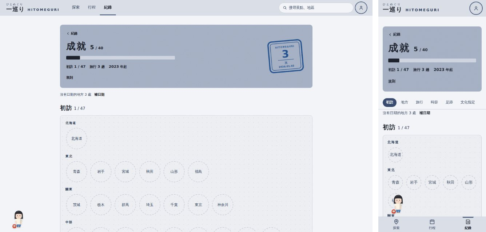

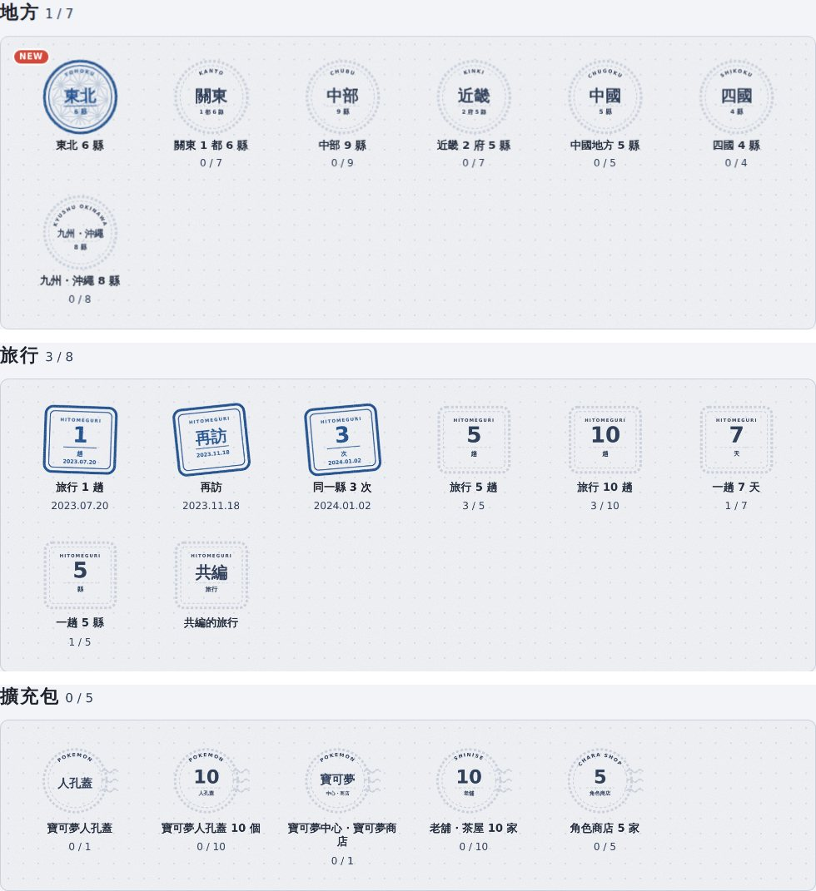

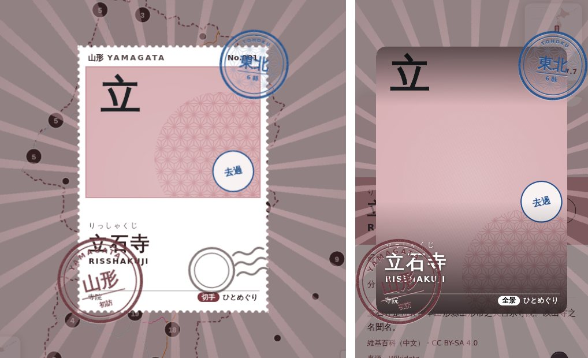

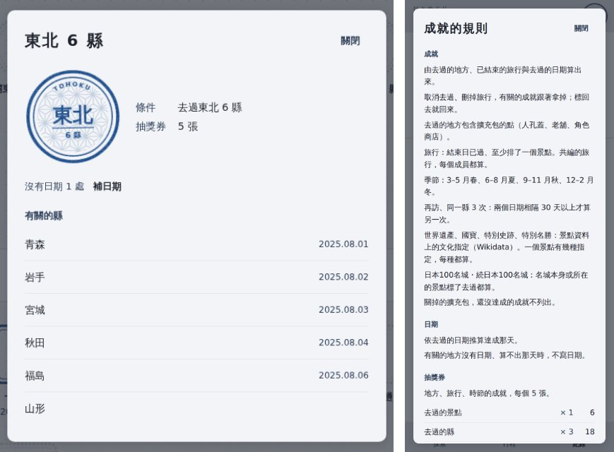

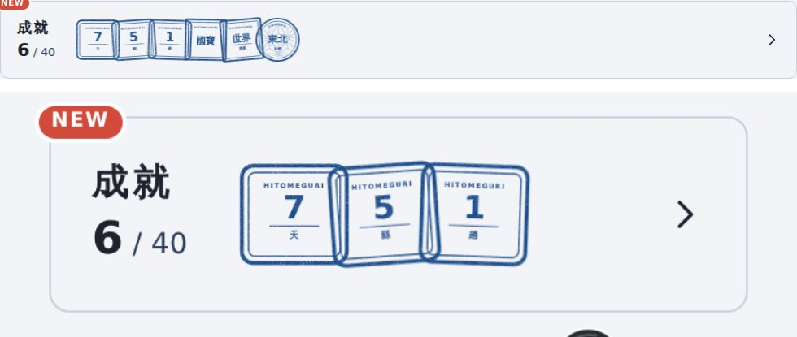

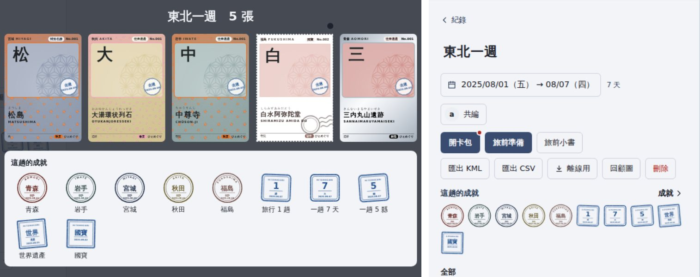

### 在 emulator 上驗收
先 `npx firebase emulators:start --project demo-hitomeguri --only auth,firestore`、`.venv/bin/python -m pipeline.cli build-bundles`、`cd web && npm run dev`，用新的測試帳號登入。

1. **東北 6 縣**：在青森、岩手、宮城、秋田、福島各找一個景點按「去過」並填日期；最後在山形的景點按「去過」。
   - 新卡入手的卡片右上蓋上「東北 6 縣」的章（山形是這縣第一個，左下同時有山形的初訪章）。
   - 紀錄頁的成就入口有 NEW；成就頁的「東北 6 縣」有 NEW，進頁面時蓋一次。
   - 收集冊的抽獎券明細「成就 1 × 5」，剩下的張數多 5。
2. **取消一縣**：把宮城的景點取消去過 → 「東北 6 縣」變回虛線（進度「還沒去：宮城」），抽獎券少 5。再標回去 → 章回來、抽獎券回來，不再標 NEW。（取消去過會清掉那個景點的日期，所以標回去後達成日不寫，頁面上方出現「補日期」。）
3. **補登一趟 7 天的旅行**：紀錄頁「補登旅行」選一週以前的日期，排 1 個以上的景點。
   - 成就頁「旅行 1 趟」「一趟 7 天」達成，日期是行程的結束日。
   - 行程頁「開卡包」翻完，下方「這趟的成就」列出這兩個（和這趟的初訪章）；行程頁標頭下方也有。
4. **名城**：在地圖上打開日本100名城的點（擴充包「城」）按去過，再到那座城對應的景點按去過 → 「日本100名城 10 城」的進度只加 1，詳細裡那座城的日期是比較早的那天。
5. **新帳號第一個去過是世界遺產**：用全新的測試帳號登入，在京都打開東寺按「去過」 → 新卡入手蓋「世界遺產」的章，讀屏是「…收進收集冊　成就　世界遺產　等 2 個」；成就頁的「世界遺產」「國寶」都有 NEW。
6. **第二台裝置**：用另一個瀏覽器（或私密視窗）登入同一個帳號 → 成就頁、紀錄頁入口都沒有 NEW，第一次打開時已達成的章依北到南蓋上一次。
7. **減少動態**：系統設定「減少動態」後按去過 → 新卡入手只淡入、淡出（不轉、不飛），這次達成的成就章一樣蓋在卡片右上（直接出現）；成就頁的蓋章直接出現（不一個一個等）。
8. **江戶主題**：`/log/achievements?theme=edo` → 達成的章是朱色，初訪章是江戶的縣色，字型換成江戶的字型。

### 自動測試
- `cd web && npm run test`（vitest，`src/services/achievements.test.ts`，46 項；CI 的前端 job 也會跑）：上下界與達成日、門檻邊界（9／10、47、名城不混続100名城）、地方名稱、季節（12–2 月冬）、30 天門檻、只有待排的行程不算、取消再勾結果一樣、NEW 的基準與比對（含 achievements.json 晚到）、去過的紀錄的指紋、旅行期間、目錄的 id（不用 `pref-` 開頭）與給券總數 95、文案不含驚嘆號・問號・emoji・「您」・「讓我們」。
- `.venv/bin/pytest -q`（`build_achievements` 3 項）。

### 需要你決定的
1. 取消去過時成就要不要永久保留？目前是跟著拿掉（和抽獎券、代表服裝一樣）。要保留的話得新增 `users/{uid}/meta/achievements` 並請你貼規則。
2. ~~服裝獎勵~~ 已做（2026-10-09）：6 個成就各送 1 件旅人的服裝，見下方「成就服裝」與 DESIGN.md §7.24。

### 成就服裝（決定事項 2，2026-10-09）
| 成就 | 服裝 | 位置 |
|---|---|---|
| 都道府縣 47 | 道中合羽 | 衣服 |
| 日本100名城 50 城 | 陣笠 | 頭上 |
| 四季 | 四季扇子 | 手上 |
| 一趟 7 天 | 唐草風呂敷 | 手上 |
| 足跡 300 處 | 金剛杖 | 手上 |
| 旅行 10 趟 | 無事蛙 | 夥伴 |

- 和代表單品一樣由紀錄算出來、不存：成就拿掉時服裝跟著拿掉；穿著的不畫（衣服換回白 T 恤），標回去就照樣穿上。不進扭蛋。
- 衣櫃：成就服裝排在不限縣的後面、各縣的前面，下面掛成就名小牌；還沒達成是剪影＋框線小牌。新達成時標 NEW。
- 成就的詳細多一列「服裝」（連到旅人頁）；成就與旅人的規則各多一條。
- 驗收：用測試帳號把 47 縣各標一個去過（日期分在 1、4、7、10 月）→ 衣櫃「衣服」「手上」出現道中合羽、四季扇子（NEW）；取消沖繩 → 道中合羽變回剪影，身上換回白 T 恤；標回去 → 又穿上，不再 NEW。
- 自動測試：`src/services/outfitOwn.test.ts`（目錄 5–8 件且成就都存在、色碼只用 token、規則列出每個成就、不進扭蛋、達成／拿掉／回來、穿在身上的）；`src/data/outfitGifts.test.ts` 產生並檢查 `outfitRewards.ts`。

## 手機版面：第一階段

（原「手機版面第一階段 驗收說明（2026-10-03）」）

計畫見 `docs/參考/手機版計畫.md` §2。使用者同意的決定：A2（1024 以下都用手機版面）、G1（離線時行程不能修改）、S2（整頁不下拉重新整理）。

### 做了什麼
- **外框**：1024 以下用手機版面（平板也是）；換頁時捲到頂、返回時回到原位置；帳號選單打橫也點得到「年代」「登出」，點選單外面不會點到底下；打字時分頁列讓開；頁面程式載不到時有提示（離線時寫「離線中，無法開啟這一頁」）；沒登入的行程、紀錄頁有「登入」鈕；打橫時讓出瀏海；360 寬的「離線」標記不斷行；手機的搜尋在點放大鏡的同時聚焦。
- **探索**：
  - 縣頁海報條拆成「‹ 全國」、縣名、「深度探索 ›」；深度探索頁補上直飛航線。
  - 地圖鏡頭扣掉上方清單與景點卡片，選取的點落在看得到的地方；祭典「在地圖上看」改成底部小卡（‹ 祭典、名稱、關閉）。
  - 景點卡片底部固定「收藏・去過・清單・加入行程」；「在 Google Maps 開啟」移到資訊列。
  - 擴充包在手機看得到、關得掉；「附近的…」第一次點就打開那個點（桌機也修了）。
  - 返回手勢先關景點卡片、搜尋列、帳號選單。
  - 清單捲到頂再往下拉不會重新整理；地圖出處一開始收起。
- **深度探索、行程、紀錄**：段落列在頁頂時亮第一段；離線時行程鎖住，標題下寫「離線中・行程不能修改」；批次補日期點整列就是勾選；經縣值的等級選單不會被分頁列蓋住。
- **收集**：打橫時卡片檢視、開卡包、新卡亮相整張放得下，按鈕排在右邊；規則捲到下面也按得到「關閉」；點收集冊地圖上的縣會停在那一縣（桌機也修了）；翻到背面再抽一張，新卡回到正面。

### 要用真的手機確認
- iPhone：點放大鏡後鍵盤會不會跳出來；打字時分頁列有沒有讓開。
- Android：返回鍵是否先關景點卡片；鍵盤收起後分頁列有沒有回來。
- 打橫時瀏海的位置（沙箱只能模擬）。

### 下一步（第二階段，已同意照建議）
景點卡片把手與三段高度、擴充包 chip 軌道、首頁縣名格、行程頁「更多」、分頁記住位置、旅途中停在今天、觸控目標 44px、復原與站內確認框等，見 `docs/參考/手機版計畫.md` §3。

## 手機版面：第二階段

（原「手機版面第二階段 驗收說明（2026-10-03）」）

計畫見 `docs/參考/手機版計畫.md` §3（1–31 項）。使用者同意的決定：B2（觸控點擊區）、C3＋chip 軌道（景點卡片三段高度）、D2（行程工具鈕）、E2（分頁記住位置）、F3（行程天數條）、H2（首頁站名板）、I2（深度探索段落列）、J3（LINE 邀請）、K2（紀錄頁第一屏）、L3（復原與站內確認框）、M2（旅人小窗）、N2（打橫精簡 header）、T1（按下去仍是往下 1px）。

已合併進 main。桌機（1024 以上、滑鼠）除了下面標「桌機也有」的地方，看起來和用起來都和原本一樣。

### 做了什麼
- **全站**：
  - 觸控時按鈕、文字連結、底線索引都撐到一指好點的大小；看起來的大小不變，地圖的縮放鈕不動。
  - 底部分頁記住各分頁上次停在哪一頁；點目前的分頁先捲回頂端，再點一次回到分頁的第一頁。
  - 取消收藏、取消去過、從清單移除、從行程移除後，下方出現一行「已取消收藏　復原」，約 6 秒收起；復原連去過的日期、停留點原本的位置一起放回去。（桌機也有）
  - 刪除行程、清單、截圖，移出成員、離開共編、重新產生連結，改用站內的確認框，預設停在「取消」。（桌機也有）
  - 類型篩選切回「不限」、收集冊切回「全部」、關掉景點卡片都比原本快；關卡片後清單停在原本捲到的地方。深度探索的地區特色改成只載入這一縣。
- **探索**：
  - 景點卡片上方有把手，可以拖成三段：只露出名稱與「去過」、半開、全開。只有把手和名稱那一帶能拖，甩一下換一段，從最低再往下拉就關掉。地圖會跟著卡片的高度，選到的點不會被蓋住。
  - 海報條下面一行膠囊：收藏、各擴充包（各自的顏色）、設定。開著的是實心，再點一下關掉。期間限定有資料時，下面多一行連到深度探索。
  - 縣地圖的清單拿掉「景點」標題，類型排成一行左右滑，清單多露出一列多。
  - 首頁改成依地方分組的站名板：一格一縣，下緣是縣色，一屏約 20 縣；標語一行。
- **深度探索**：
  - 海報捲走後，段落列換成地區色，左邊「‹ 京都」回縣地圖。在祭典時第二列是月份，在地區特色時是組別。
  - 祭典「在地圖上看」之後返回，回到原本那張卡，月份篩選與展開的月份也還在。
  - 地區特色卡在手機改成縮圖在左的橫排，一張大約只剩一半高；平板的祭典排兩欄。
  - 截圖檢視可以左右滑換張、點背景關閉，框跟著圖片的高度。
- **行程**：
  - 整頁一起捲。天數條（DAY 1…、待排、地圖）貼在上緣，一次看一天；地圖預設收起，打開只顯示選中的那天。第一個停留點從第二屏移到第一屏。
  - 旅途中進來就停在今天，地圖打開；天數條與 DAY 標記下有「今日」。
  - 工具鈕只留「旅前準備」「旅前小書」「離線用」「更多」，KML、CSV、回顧圖、刪除行程收在「更多」裡，刪除排在最後、用紅字。
  - 觸控時停留點不顯示拖曳把手和「移到」下拉；改用「⋯」選單：移到最前、往前、往後、移到最後、移到哪一天或待排、從行程移除。
  - 每天第一站上面有「從目前位置」；停留點下面有「Google Maps 路線」，站太多時拆成「1–5」「5–8」幾段。（桌機也有）
  - 共編從下方出現；手機有系統分享時「複製」換成「傳送」。邀請連結從 LINE 打開會改用外部瀏覽器；在 App 內建的瀏覽器裡，加入頁的「登入」換成「用瀏覽器開啟」與「複製連結」。
- **紀錄**：
  - 第一屏：收集冊縮成一條，經縣值、旅人、成就三格一列，下面一行「收藏・清單」，再來是貼在上緣的「旅行・去過」。
  - 經縣值：點縣後在分頁列上方出現一條「縣名＋6 段等級」；點到海上會選最近的縣；沖繩的框放大約 3 倍（收集冊地圖、位置小框、分享圖也一樣，桌機也有）；47 縣清單上方有地方的段落列。
  - 批次補日期的工具列貼在分頁列上方，一行「已選・日期・套用・完成」。
  - 清單名稱太長時顯示兩行。清單列的「去過」和「×」中間隔開。（桌機也有）
- **收集**：
  - 收集冊的海報縮成一條，券列一行，篩選一行左右滑；第一列卡片從畫面下緣移到大約中間。
  - 收集冊多一條貼在上緣的縣名小牌（縣名＋張數），跟著捲到的縣，點了跳過去、篩選不變。
  - 旅人選衣服時，展示窗往上捲會縮成上緣的小窗，娃娃一直看得到；衣櫃的分頁平分寬度，不再左右捲。
  - 十連抽在手機排成 3 欄；卡片檢視的「關閉」在右上角，觸控時點卡片翻面，按鈕排得下一行。
- **打橫**：
  - header 變矮，探索・行程・紀錄放進 header，下方不顯示分頁列。
  - 地圖頁的清單和景點卡片改成左邊一欄，地圖用右邊；景點卡片在這裡不能拖。
  - 經縣值地圖、紀錄頁小地圖、練習卡都放得進一屏；練習卡在左、按鈕在右。

（沙箱連不到地圖與照片，所以地圖是空白、照片是灰框。）

### 要用真的手機確認
- 景點卡片拖起來順不順、甩一下換段的力道是否自然；iPhone 網址列收放時，半開的高度會不會跳。
- 從 LINE 點邀請連結：會不會跳到外部瀏覽器；在 LINE 裡打開加入頁時，「用瀏覽器開啟」有沒有作用。
- 「傳送」叫出的系統分享選單；取消分享時不會跳錯誤。
- 「Google Maps 路線」在手機打開 Google Maps App 時，停留點有沒有照順序帶進去；「從目前位置」是否從所在地出發。Google Maps 與 LINE 的官方說明頁在沙箱打不開，是用搜尋到的原文摘錄確認的。
- 經縣值點到海上時選到的縣是否是手指想點的那個。
- 打橫時 header 與瀏海、Home 指示條的位置。
- 沙箱的資料庫模擬器在最後一輪停擺，紀錄頁的「補日期」與行程頁最後的修正是用頁面裡放的資料測的，請在手機上實際補一次日期、開一次旅途中的行程。

### 下一步
- 這一階段沒有改 Firestore 規則。
- 第三階段（可以晚點）：位置小框的位置、成就頁最新印章、季節曆、補登旅行表單、匯出選單、/trips 排序、旅前小書工具列、扭蛋黑色小方塊、主畫面圖示、換分頁的淡入淡出、小字級收成三階，見 `docs/參考/手機版計畫.md` §4。
- 類型篩選時地圖仍是整份重畫（分群的數字要跟著篩選），要再快得把每個類型拆開，留到之後再看。

## 手機版面：第三階段

（原「手機版面第三階段 驗收說明（2026-10-03）」）

計畫見 `docs/參考/手機版計畫.md` §4（1–11 項）。使用者同意的決定：O1（位置小框在清單或景點卡片的左緣）、P2（一顆「匯出 ▾」，能分享檔案時走系統分享）、Q2（主畫面圖示在建置時產生）、R3（小字級收成三階）。

已合併進 main。桌機（1024 以上、滑鼠）除了下面標「桌機也有」的地方，看起來和用起來都和原本一樣。

### 做了什麼
- **探索**：
  - 縣地圖的位置小框改到左邊、變窄：清單開著時在清單下面，景點卡片或祭典小卡打開時在卡片上面，不再被清單蓋住，也不會碰到上方的膠囊列和右邊的縮放鈕。上下放不下時不顯示；打橫照舊不顯示。縣名加倍率放不下一行時，倍率換到第二行。
  - 縣地圖剛打開、整縣都在畫面裡時看不到小框，放大之後才出現（和原本一樣）。
- **深度探索**：季節曆的櫻花開花和滿開太近時畫成一條，不再疊成「(●」；月份只標單數月，格線與本月的底色不變。上方的觀測站，北海道 8 站在 360 寬也排成一行。
- **行程**：
  - /trips 先列已有的行程，下面一顆「新增行程」，按了才展開表單，名稱欄直接可以打字。已結束的旅行排在最後。
  - 旅前小書的工具列收成一列：「‹ 旅前準備」「內容 ▾」「列印／存成 PDF」。紙張 A5／A4 與五個段落的勾選放在「內容 ▾」裡，勾選時不會收起，點外面或按 Esc 收起。
  - 行程頁「更多 ▾」裡的 KML、CSV 也改成能分享就分享。
- **匯出**：
  - 收藏與清單、單一清單、紀錄頁的「去過」，KML 和 CSV 收成一顆「匯出 ▾」。清單頁的改名、刪除清單也在同一個選單裡，用線隔開，刪除排在最後。
  - 手機能分享檔案時（例如 CSV）叫出系統分享選單，可以直接傳給其他 App；不能分享的照舊下載（例如 Chrome 不分享 KML）。取消分享就結束，不會跳錯誤。
  - 沒有可匯出的項目時「匯出 ▾」是灰的；空的清單仍可以打開選單改名或刪除。
- **紀錄**：
  - 成就頁標頭右上放最近達成的一枚章；還沒有成就時不放。
  - 補登旅行的表單：名稱整行，日期與「新增」排在下一行。月曆開在上個月（桌機也有）。日期面板和下拉選單不會蓋到分頁列。
- **主畫面圖示**：加到主畫面時的圖示改成和開場畫面一樣的 47 縣圓點圓環，顏色從各縣的地區色來；iPhone 與 Android（含裁成圓形的圖示）各有一張。原本只有網頁小圖示。（2026-10-11 改成「巡の輪」：圓環中央加了墨色的「巡」，圓點換成各縣的 strong 色；網頁小圖示也換掉，見 DESIGN.md §1b）
- **換頁**：手機換分頁（探索、行程、紀錄）時直接換，不再淡入淡出；換縣的墨暈、同一個分頁裡的換頁、桌機的換頁照舊。開場動畫沒有動。
- **字級**（桌機也有）：小字從四種收成三種，原本 13 的按鈕、膠囊、段落列、小標、返回連結都變成 14，看起來略大一點。窄的地方用 12：景點卡片底部的「收藏・去過・清單・加入行程」、成就格的名稱。量過 360、390 與桌機，現代與昭和，沒有新的截字或斷行。

（沙箱連不到地圖與照片，所以地圖是空白、照片是灰框。）

### 扭蛋獎品左上的黑色小方塊
查過來源，是沙箱瀏覽器用軟體畫圖時才出現的，程式本身沒有問題，所以沒有改。請在手機上抽一次扭蛋看獎品左上角；真的手機也有的話再修。

### 要用真的手機確認
- 「匯出 ▾」的 CSV：iPhone 與 Android 會不會叫出系統分享選單，傳到 LINE、存到檔案後打開是不是正常的中文（不是亂碼）；KML 是不是照舊下載。分享檔案的官方說明頁在沙箱打不開，是用搜尋到的原文摘錄確認的。
- 加到主畫面：iPhone（Safari「加入主畫面」）與 Android（Chrome「安裝應用程式」）的圖示是不是 47 縣圓環，Android 裁成圓形時圓點有沒有被切掉。已經加過的要先刪掉再加一次才會換新圖示。
- 換分頁時直接換、沒有閃一下；換縣時的墨暈還在。
- 扭蛋獎品左上角有沒有黑色小方塊。
- 字級變大之後，常用的頁面有沒有哪裡擠或斷行怪。

### 下一步
- 這一階段沒有改 Firestore 規則。
- 開場動畫對回訪者要不要縮短，等使用者決定（`docs/參考/手機版計畫.md` §4 第 10 項）。
- 驗收後合併進 main，推上去就會部署。
